# The Windows 11 Start menu styling guide

## Table of contents

* [Introduction](#introduction)
  * [Finding targets](#finding-targets)
  * [Missing customizations](#missing-customizations)
  * [Contributing](#contributing)
* [Themes](#themes)
  * [Windows 10 Start menu themes](#windows-10-start-menu-themes)
* [Custom Acrylic background](#custom-acrylic-background)
* [Change the Start menu size](#change-the-start-menu-size)
* [Remove the drop shadows](#remove-the-drop-shadows)
* [Remove the search box](#remove-the-search-box)
* [Style the Start menu search box](#style-the-start-menu-search-box)
* [Move pinned app lists](#move-pinned-app-lists)
* [Remove the Recommended section](#remove-the-recommended-section)
* [Hide or rename the section headers](#hide-or-rename-the-section-headers)
* [Hide the All apps buttons](#hide-the-all-apps-buttons)
* [Remove the user profile button](#remove-the-user-profile-button)
* [Move the power button](#move-the-power-button)
* [Hide the Phone Link panel](#hide-the-phone-link-panel)
* [Context menus and tooltips](#context-menus-and-tooltips)
* [Force light/dark mode](#force-lightdark-mode)
* [Other common targets](#other-common-targets)
* [Visual states](#visual-states)
* [Transforms](#transforms)
  * [Translate](#translate)
  * [Rotate](#rotate)
  * [Scale](#scale)
  * [Skew](#skew)
  * [Other properties and attributes](#other-properties-and-attributes)
* [Colors](#colors)
  * [Solid color](#solid-color)
  * [Accent colors](#accent-colors)
  * [Clear transparent background](#clear-transparent-background)
  * [Acrylic effect as color](#acrylic-effect-as-color)
  * [WindhawkBlur effect as color](#windhawkblur-effect-as-color)
  * [Mica effect as color](#mica-effect-as-color)
  * [Gradient as color](#gradient-as-color)
  * [Image as color](#image-as-color)
  * [Reveal as color](#reveal-as-color)
* [Search menu](#search-menu)
* [Search menu remote debugging](#search-menu-remote-debugging)
* [Search menu WebView styles](#search-menu-webview-styles)
  * [Hide the back button](#hide-the-back-button)
  * [Hide the Copilot button](#hide-the-copilot-button)
  * [Change the background color of search type headers](#change-the-background-color-of-search-type-headers)
  * [Hide the search type headers](#hide-the-search-type-headers)
  * [Hide the search type header scroll buttons](#hide-the-search-type-header-scroll-buttons)
  * [Hide the quick settings panel](#hide-the-quick-settings-panel)
  * [Hide the top result title](#hide-the-top-result-title)
  * [Change the background color of all search results](#change-the-background-color-of-all-search-results)
  * [Change the corner radius of search results](#change-the-corner-radius-of-search-results)
  * [Change the background color of search result groups](#change-the-background-color-of-search-result-groups)
  * [Change the style of search result group titles](#change-the-style-of-search-result-group-titles)
  * [Change the width of the preview panel](#change-the-width-of-the-preview-panel)
  * [Hide the preview panel](#hide-the-preview-panel)
  * [Change the text font](#change-the-text-font)

## Introduction

This is a collection of commonly requested Start menu styling customizations for
Windows 11. It is intended to be used with the [Windows 11 Start Menu
Styler](https://windhawk.net/mods/windows-11-start-menu-styler) Windhawk mod.

If you're not familiar with Windhawk, here are the steps for installing the mod:

* Download Windhawk from [windhawk.net](https://windhawk.net/) and install it.
* Go to "Mods" in the upper right menu.
* Find and install the "Windows 11 Start Menu Styler" mod.

After installing the mod, open its Settings tab and adjust the styles according
to your preferences.

Some customizations are best adjusted with other Windhawk mods. Links to those
mods are provided where applicable.

Windows 11 has two versions of the Start menu: the classic one, and the
[redesigned one](https://microsoft.design/articles/start-fresh-redesigning-windows-start-menu/)
that is available on version 24H2 and later. Some targets differ between the
two. Customizations that only apply to one of them say so.

**See also**: [The Windows 11 taskbar styling
guide](https://github.com/ramensoftware/windows-11-taskbar-styling-guide/blob/main/README.md),
[The Windows 11 notification center styling
guide](https://github.com/ramensoftware/windows-11-notification-center-styling-guide/blob/main/README.md).

### Finding targets

[How to find targets using UWPSpy](https://github.com/bbmaster123/FWFU/blob/main/Guides/uwpspy.md).

### Missing customizations

If you're looking for a customization that is not listed here, please [open an
issue](https://github.com/ramensoftware/windows-11-start-menu-styling-guide/issues/new).

### Contributing

If you have a Start menu styling customization or theme that you would like to
share, please submit a pull request.

## Themes

Themes are collections of styles that can be imported into the Windows 11
Start Menu Styler mod. The following themes are available:

| Link | Screenshot
| ---- | ----------
| [TranslucentStartMenu](Themes/TranslucentStartMenu/README.md) | [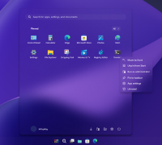](Themes/TranslucentStartMenu/screenshot.png)
| [NoRecommendedSection](Themes/NoRecommendedSection/README.md) | [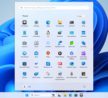](Themes/NoRecommendedSection/screenshot.png)
| [SideBySide](Themes/SideBySide/README.md) | [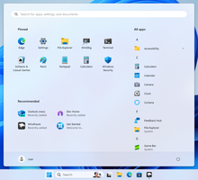](Themes/SideBySide/screenshot.png)
| [SideBySide2](Themes/SideBySide2/README.md) | [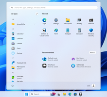](Themes/SideBySide2/screenshot.png)
| [SideBySideMinimal](Themes/SideBySideMinimal/README.md) | [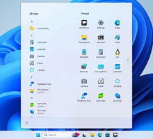](Themes/SideBySideMinimal/screenshot.png)
| [Down Aero](Themes/Down%20Aero/README.md) | [](Themes/Down%20Aero/screenshot.png)
| [Windows10](Themes/Windows10/README.md) | [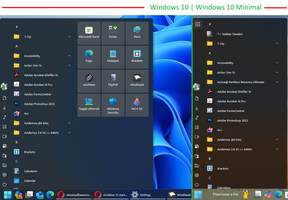](Themes/Windows10/screenshot.png)
| [Windows11_Metro10](Themes/Windows11_Metro10/README.md) | [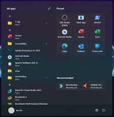](Themes/Windows11_Metro10/screenshot.png)
| [Fluent2Inspired](Themes/Fluent2Inspired/README.md) | [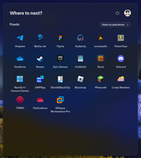](Themes/Fluent2Inspired/screenshot.png)
| [RosePine](Themes/RosePine/README.md) | [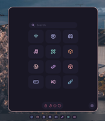](Themes/RosePine/screenshot.png)
| [Windows11_Metro10Minimal](Themes/Windows11_Metro10Minimal/README.md) | [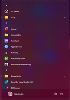](Themes/Windows11_Metro10Minimal/screenshot.png)
| [Everblush](Themes/Everblush/README.md) | [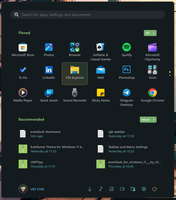](Themes/Everblush/screenshot.png)
| [SunValley](Themes/SunValley/README.md) | [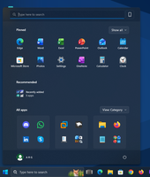](Themes/SunValley/screenshot.png)
| [SunValley (Legacy)](Themes/21996/README.md) | [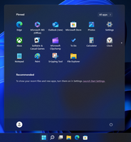](Themes/21996/screenshot.png)
| [UniMenu](Themes/UniMenu/README.md) | [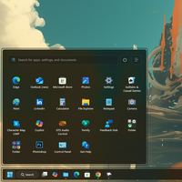](Themes/UniMenu/screenshot.png)
| [LegacyFluent](Themes/LegacyFluent/README.md) | [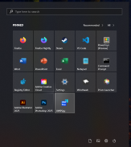](Themes/LegacyFluent/screenshot.png)
| [OnlySearch](Themes/OnlySearch/README.md) | [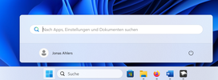](Themes/OnlySearch/screenshot.png)
| [WindowGlass](Themes/WindowGlass/README.md) | [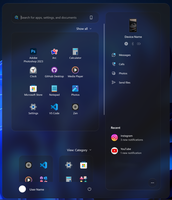](Themes/WindowGlass/screenshot.png)
| [Fluid](Themes/Fluid/README.md) | [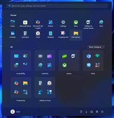](Themes/Fluid/screenshot.png)
| [Oversimplified&Accentuated](Themes/Oversimplified&Accentuated/README.md) | [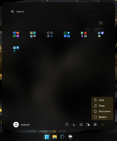](Themes/Oversimplified&Accentuated/screenshot.png)
| [LiquidGlass](Themes/LiquidGlass2/README.md) | [](Themes/LiquidGlass2/screenshot.png)
| [LiquidGlass (Legacy)](Themes/LiquidGlass/README.md) | [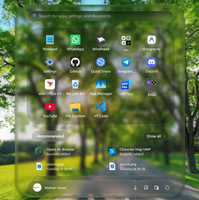](Themes/LiquidGlass/screenshot.png)
| [Windows10X](Themes/Windows10X/README.md) | [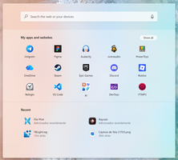](Themes/Windows10X/screenshot.png)
| [TintedGlass](Themes/TintedGlass/README.md) | [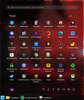](Themes/TintedGlass/screenshot.png)
| [LayerMicaUI](Themes/LayerMicaUI/README.md) | [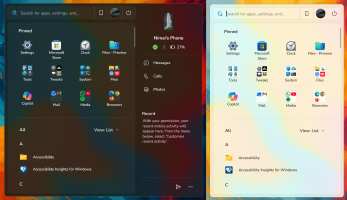](Themes/LayerMicaUI/screenshot.png)
| [Borderless](Themes/Borderless/README.md) | [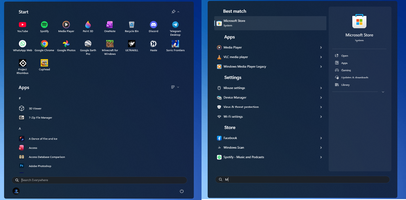](Themes/Borderless/screenshot.png)
| [Command Center](Themes/Command%20Center/README.md) | [](Themes/Command%20Center/screenshot.png)
| [FullScreen](Themes/FullScreen/README.md) | [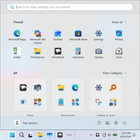](Themes/FullScreen/screenshot.png)
| [FrostyGlass](Themes/FrostyGlass/README.md) | [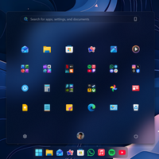](Themes/FrostyGlass/screenshot.png)
| [FlyoutStartMenu](Themes/FlyoutStartMenu/README.md) | [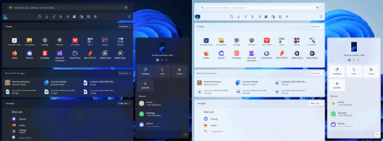](Themes/FlyoutStartMenu/screenshot.png)
| [OS26 Tahoe App Launcher](Themes/OS26%20Tahoe%20App%20Launcher/README.md) | [](Themes/OS26%20Tahoe%20App%20Launcher/screenshot.png)
| [Raycast](Themes/Raycast/README.md) | [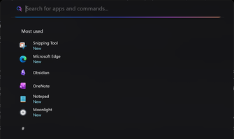](Themes/Raycast/screenshot.png)

### Windows 10 Start menu themes

The themes below are designed for customizing the Windows 10 Start menu. They
aren't integrated into the Windows 11 Start Menu Styler mod, and must be
imported manually. For details, see their respective README files.

| Link | Screenshot
| ---- | ----------
| [ModernStartMenu](Themes/ModernStartMenu/README.md) | [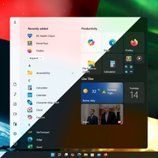](Themes/ModernStartMenu/screenshot.png)
| [Hybrid](Themes/Hybrid/README.md) | [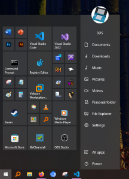](Themes/Hybrid/screenshot.png)

## Custom Acrylic background

Target `Border#AcrylicBorder` for the Start menu or `Border#AppBorder, Border#AccentAppBorder` for the search menu, then set `Background` to an `AcrylicBrush` object. The search menu uses one of its two borders at a time, so target both.

For example:

```
Background:=<AcrylicBrush BackgroundSource="Backdrop" TintColor="Pink" TintOpacity="0.25" />
```

The [AcrylicBrush properties](https://learn.microsoft.com/en-us/uwp/api/windows.ui.xaml.media.acrylicbrush?view=winrt-22621#properties)
can be adjusted as needed.

Both menus also have a tint layer on top of the background. To keep it from covering the custom background, target `Border#AcrylicOverlay` for the Start menu or `Border#LayerBorder, Border#AccentLayerBorder` for the search menu with `Visibility=Collapsed`.

## Change the Start menu size

Use the [Start Menu Size](https://windhawk.net/mods/start-menu-size) mod, or set the size with the styles below.

For the redesigned Start menu, target `Grid#MainMenu` with `Width=650` and `Grid#FrameRoot` with `Height=750`.

For the classic Start menu, target:
```
StartDocked.StartSizingFrame
```
Styles:
```
MinWidth=500
MaxHeight=580
```
And target:
```
StartDocked.LauncherFrame > Grid#RootGrid > Grid#RootContent, StartDocked.LauncherFrame > Grid#RootPanel > Grid#RootGrid > Grid#RootContent
```
Styles:
```
MinWidth=500
MaxWidth=500
```

Adjust values as needed.

## Remove the drop shadows

Target:
```
Border#StartDropShadow, Border#RootGridDropShadow, Border#DropShadow, Border#RightCompanionDropShadow, Border#dropshadow
```
Style:
```
Visibility=Collapsed
```

To remove only some of the shadows, use the relevant targets:

| Target | Shadow
| ------ | ------
| `Border#StartDropShadow`, `Border#RootGridDropShadow`, `Border#DropShadow` | Start menu, the element depends on the Windows version
| `Border#RightCompanionDropShadow` | Phone Link panel
| `Border#dropshadow` | Search menu

## Remove the search box

For the redesigned Start menu, target `StartMenu.SearchBoxToggleButton` with `Visibility=Collapsed`.

For the classic Start menu, target `StartDocked.SearchBoxToggleButton` with `Height=0`, `Margin=0,0,0,24`.

## Style the Start menu search box

To change the background and the border, target:
```
StartMenu.SearchBoxToggleButton > Grid > Border#BorderElement, StartDocked.SearchBoxToggleButton > Grid > Border#BorderElement
```
Styles:
```
Background=<color>
BorderBrush=<color>
BorderThickness=<thickness>
CornerRadius=<radius>
```

See the [colors section](#colors) for all color options. To also change the background on hover, see [visual states](#visual-states).

To change the placeholder text, target `TextBlock#PlaceholderText` with `Text=<text>`.

To replace the search icon image with a font icon, target `Image#SearchIconOn, Image#SearchIconOff` with `Visibility=Collapsed` and `FontIcon#SearchGlyph` with `Visibility=Visible`.

## Move pinned app lists

Target `StartMenu.PinnedList` with `Margin=0,0,0,0`.
Adjust values as needed.

## Remove the Recommended section

> [!NOTE]
> The redesigned Start menu [provides an
> option](https://www.windowslatest.com/2025/06/15/remove-turn-off-windows-11-start-menu-recommended-section-version-24h2/)
> to disable the Recommended section natively.

For the redesigned Start menu, target `Grid#TopLevelSuggestionsRoot` with `Visibility=Collapsed`.

For the classic Start menu, target the following elements, or use the [NoRecommendedSection](Themes/NoRecommendedSection/README.md) theme:

* `Windows.UI.Xaml.Controls.Grid#TopLevelSuggestionsListHeader` with `Visibility=Collapsed`
* `Windows.UI.Xaml.Controls.Grid#NoTopLevelSuggestionsText` with `Visibility=Collapsed`
* `Windows.UI.Xaml.Controls.Grid#TopLevelSuggestionsContainer` with `Height=0`
* `Windows.UI.Xaml.Controls.GridView#RecommendedList` with `Visibility=Collapsed`
* `Windows.UI.Xaml.Controls.Grid#ShowMoreSuggestions` with `Visibility=Collapsed`

In addition, the pinned items can be adjusted to
occupy the whole height by targeting `StartMenu.PinnedList` and setting
`Height=504`.

## Hide or rename the section headers

Target the text of the relevant header:

* `TextBlock#PinnedListHeaderText` for "Pinned"
* `TextBlock#TopLevelSuggestionsListHeaderText` for "Recommended"
* `TextBlock#AllListHeadingText` for "All" in the redesigned Start menu
* `TextBlock#AllAppsHeading` for "All" on the All apps page of the classic Start menu

Use `Visibility=Collapsed` to hide it, or `Text=<text>` to rename it.

## Hide the All apps buttons

In the classic Start menu, target `Button#ShowAllAppsButton` and `Button#CloseAllAppsButton` with `Visibility=Collapsed`.

## Remove the user profile button

Target `StartDocked.UserTileView` with `Visibility=Collapsed`.

## Move the power button

Target `StartDocked.PowerOptionsView` with `Margin=-580,-1330,0,0`.
Adjust values as needed.

## Hide the Phone Link panel

In the redesigned Start menu, target `Grid#RightCompanionContainerGrid` for the panel and `Windows.UI.Xaml.Controls.Primitives.ToggleButton#ShowHideCompanion` for the button that toggles it, both with `Visibility=Collapsed`.

## Context menus and tooltips

To style context menus, target:
```
MenuFlyoutPresenter > Border
```
Styles:
```
Background=<color>
BorderBrush=<color>
BorderThickness=<thickness>
CornerRadius=<radius>
```

When changing the corner radius, also target `MenuFlyoutPresenter` with the same `CornerRadius`. To round the menu items, target `MenuFlyoutItem` with `CornerRadius=<radius>`.

To style tooltips, target:
```
ToolTip > ContentPresenter#LayoutRoot
```
Styles:
```
Background=<color>
BorderBrush=<color>
BorderThickness=<thickness>
CornerRadius=<radius>
```

See the [colors section](#colors) for all color options.

## Force light/dark mode

Sets light/dark mode independently of what is set in Windows.

Target `Grid` for both the Start menu and the search menu, or `Cortana.UI.Views.TaskbarSearchPage > Grid#RootGrid` for the search menu only, with:

`RequestedTheme=1`

`1` = Light Mode

`2` = Dark mode

## Other common targets

These elements are also commonly styled by themes:

| Target | Element
| ------ | -------
| `Windows.UI.Xaml.Controls.Primitives.ScrollBar` | Scrollbars, use `Visibility=Collapsed` to hide them
| `Microsoft.UI.Xaml.Controls.PipsPager#PinnedListPipsPager` | Page dots of the pinned list
| `Grid#NavPanePlaceholder` | Bottom bar of the redesigned Start menu
| `StartDocked.NavigationPaneView#NavigationPane` | Bottom bar of the classic Start menu
| `StartDocked.AppListView#NavigationPanePlacesListView` | Folder shortcuts next to the power button
| `StartMenu.CategoryControl` | Category items in the All section of the redesigned Start menu
| `Microsoft.UI.Xaml.Controls.DropDownButton#ViewSelectionButton` | View selector of the All section of the redesigned Start menu

## Visual states

Some elements change their look depending on their state, for example when hovered or pressed. To set a style for a specific state, add the visual state group name to the target with `@`, and the state name to the style. The group name can be added to the target itself or to one of its parents, but only once per target.

For example, to change the look of app items in the Start menu when hovered or pressed, target:
```
Border#ContentBorder@CommonStates > Grid > Border#BackgroundBorder
```
Styles:
```
Background@PointerOver=<color>
BorderBrush@PointerOver=<color>
Background@Pressed=<color>
BorderBrush@Pressed=<color>
```

The most common group is `CommonStates`, with the `Normal`, `PointerOver` and `Pressed` states. The Start menu search box also has the `Checked`, `CheckedPointerOver` and `CheckedPressed` states.

See [Finding targets](#finding-targets) on how to use UWPSpy to find all of the available visual states for an element.

## Transforms

You can use transformation styles to translate, rotate, scale, or skew elements.

> [!TIP]
> **Should I use `RenderTransform` or `Transform3D`?**
>
> For 2D transformations, it is best to stick to `RenderTransform` in most cases. Using `Transform3D` for 2D transformations can cause elements to become blurry. For 3D transformations, you must use `Transform3D`.

> [!TIP]
> You can mix and match transformations when using `Transform3D`! You can also use `RenderTransform` and `Transform3D` together.
>
> For example: `Transform3D:=<CompositeTransform3D ScaleX="1.5" TranslateY="-15" RotationZ="15" />`

### Translate

```
RenderTransform:=<TranslateTransform X="15" Y="-15" />
```

-- or --

```
Transform3D:=<CompositeTransform3D TranslateX="15" TranslateY="-15" TranslateZ="-15" />
```

### Rotate

```
RenderTransform:=<RotateTransform Angle="15" />
```

-- or --

```
Transform3D:=<CompositeTransform3D RotationX="-15" RotationY="15" RotationZ="-15" />
```

- `X`: 3D vertical rotation.
- `Y`: 3D horizontal rotation.
- `Z`: 2D rotation.

### Scale

```
RenderTransform:=<ScaleTransform ScaleX="1.5" ScaleY="-1.5" />
```

-- or --

```
Transform3D:=<CompositeTransform3D ScaleX="-1.5" ScaleY="1.5" ScaleZ="-1.5" />
```

### Skew

```
RenderTransform:=<SkewTransform AngleX="-15" AngleY="15" />
```

### Other properties and attributes

- Applies to Rotate, Scale and Skew:
  - `CenterX`: Offsets the transform's origin on the X axis.
  - `CenterY`: Offsets the transform's origin on the Y axis.
  - `CenterZ`: Offsets the transform's origin on the Z axis. (Only for `Transform3D`)

  Example:
  ```
  RenderTransform:=<RotateTransform Angle="15" CenterX="10" CenterY="20" />
  ```
- `RenderTransformOrigin`
  - Applies to `RenderTransform` only, `Transform3D` does not support this attribute. It is a separate attribute and is not set inside of the `RenderTransform` like `CenterX/Y/Z`.
  - Sets the transform origin relative to its target's width and height. Format is `X,Y` and both numbers range from 0-1.

  Example:

  ```
  RenderTransformOrigin=0.5,0.5
  ```
  This centers the transform's origin.

- `TransformGroup`
  - Applies to `RenderTransform` only, `Transform3D` does not support this attribute. It is a separate attribute and is not set inside of the `RenderTransform` like `CenterX/Y/Z`.
  - Allows you to combine RenderTransforms together into one style, mimicking Transform3D's functionality.

  Example:
  ```
  RenderTransform:=<TransformGroup><RotateTransform Angle="15" /><TranslateTransform X="15" Y="-15" /></TransformGroup>
  ```
## Colors

In the following examples, we will use `Background` as our style, but this
also works for other properties that accept colors, such as `Fill`.

### Solid color

```
Background=<color>
```

Replace `<color>` with the desired color.

A color can be a name (e.g. `Red`) or a hex code (e.g. `#FF0000`).

The color can be semi-transparent (e.g. `#80FF0000`). To have a fully
transparent background, use `Transparent` or `#00000000`.

### Accent colors

A color can also be a `ThemeResource` or `StaticResource`. There are many such
styles built into Windows.

```
Background:=<SolidColorBrush Color="{ThemeResource SystemAccentColor}" Opacity="0.8" />
```

Accent colors come as part of an accent color palette. This means that for any color you pick as your system accent color, 3 additional shades are part of that color's palette. For example: `SystemAccentColorLight2` or `SystemAccentColorDark1`.

The word `Light` or `Dark` is appended at the end with a number ranging from 1
to 3. See [the official Microsoft
docs](https://learn.microsoft.com/en-us/windows/apps/design/style/color#accent-color-palette)
for more information.

```
Background:=<SolidColorBrush Color="{ThemeResource SystemAccentColorDark2}" Opacity="0.5" />
```

### Clear Transparent Background

To have a fully transparent background:

Style:
```
Background=Transparent
```

### Acrylic effect as color

In order to use the acrylic effect (a blurred background) you can use the
`AcrylicBrush`.

```
Background:=<AcrylicBrush TintColor="Black" TintOpacity="0.8" />
```

`TintColor` - Required. Defines what color to use.

`TintOpacity` - Defines the strength of the chosen color.

`TintLuminosityOpacity` - Defines the brightness of the acrylic effect.

`BackgroundSource` - Defines what should be considered the background of the acrylic effect. Set to "Backdrop" to use the desktop wallpaper.

`Opacity` - Defines how transparent the brush effect itself is. If set to less than 1, it blends the AcrylicBrush with clear transparency.

You can also set Acrylic to use an accent color for a more dynamic look that fits the current theme.

```
Background:=<AcrylicBrush TintColor="{ThemeResource SystemAccentColorDark2}" TintOpacity="0.3" />
```

### WindhawkBlur effect as color

An alternative to Acrylic is the mod's own blur implementation called `WindhawkBlur`. It differs from Acrylic in that its blur radius, saturation and noise are customizable, and it keeps blurring when battery saver is on or transparency effects are off, unless `FallbackColor` is set.

```
Fill:=<WindhawkBlur BlurAmount="10" TintColor="#80ff0000" />
```

`BlurAmount` - Radius of the blur effect. Set to 30 to roughly mimic Acrylic. Defaults to 0 (no blur).

`TintColor` - Color applied to the blur. Accepts a hex color in `#AARRGGBB` or `#RRGGBB` format, or a `ThemeResource` such as `{ThemeResource SystemAccentColor}`. Color names like `Red` are not supported. Defaults to transparent (no visible tint).

`TintOpacity` - Opacity of the tint, between 0.0 and 1.0. Overrides the alpha component of `TintColor` when set. If omitted, the alpha component of `TintColor` is used (255 for `#RRGGBB`).

`TintLuminosityOpacity` - Shifts pixel luminance towards the tint color's luminance. Range: 0.0 to 1.0. Defaults to 0.0 (no luminosity blend).

`TintSaturation` - Saturation of the blurred content. 1.0 is unchanged, 0.0 is fully desaturated (grayscale). Defaults to 1.0.

`NoiseOpacity` - Visibility of an added procedural noise texture overlay. Range: 0.0 to 1.0. Defaults to 0.0 (no noise).

`NoiseDensity` - Granularity of the noise texture. Defaults to 1.0.

`FallbackColor` - Color used in place of the blur effect when battery saver is on or when transparency effects are disabled in the system settings. Accepts a hex color or a `ThemeResource`. If omitted, the blur effect is used regardless of those settings.

The following two examples produce the same effect, a red tint at 50% opacity:

```
Fill:=<WindhawkBlur BlurAmount="10" TintColor="#80ff0000" />
Fill:=<WindhawkBlur BlurAmount="10" TintColor="#ff0000" TintOpacity="0.5" />
```

> [!TIP]
> There is no need to specify a `TintOpacity` value if your `TintColor` already has an alpha component.

You can use a `ThemeResource` for a dynamic look that fits the current theme, optionally paired with a `FallbackColor`:

```
Fill:=<WindhawkBlur BlurAmount="10" TintColor="{ThemeResource SystemAccentColor}" TintOpacity="0.5" FallbackColor="{ThemeResource SystemAccentColorDark1}" />
```

### Mica effect as color

> [!NOTE]
> Unfortunately, it is not possible to set a Mica effect at this time with any of Windhawk's styler mods.

### Gradient as color

The background can also be a gradient. For example, to have a gradient from
yellow to red to blue to lime green, use the following style:

```
Background:=<LinearGradientBrush StartPoint="0,0.5" EndPoint="1,0.5"><GradientStop Color="Yellow" Offset="0.0" /><GradientStop Color="Red" Offset="0.25" /><GradientStop Color="Blue" Offset="0.75" /><GradientStop Color="LimeGreen" Offset="1.0" /></LinearGradientBrush>
```

### Image as color

The background can also be an image:

```
Background:=<ImageBrush Stretch="UniformToFill" ImageSource="<image>" />
```

Replace `<image>` with your own image, a URL or a local file path.
If you only see a fully transparent background when using a local file path, you must set a URL instead.
Images can be jpg, jpg XR, png, bmp, svg, tiff, gif, or ico.

Stretch can be set to the following values:

`None` - Image is rendered at its native resolution and aspect ratio.

`Fill` - Image is stretched or squished to fill the size of the element.

`Uniform` - Image is resized to fit the element dimensions, while it preserves its native aspect ratio.

`UniformToFill` - Image is resized to fill the destination dimensions while it preserves its native aspect ratio. Crops to fit element.

### Reveal as color

> [!NOTE]
> Reveal is a deprecated XAML feature. It may have issues
> or stop working at any time.

Reveal is the cursor-based illumination effect from Windows 10.

```
Background:=<RevealBorderBrush Color="Transparent" TargetTheme="1" Opacity="1" />
```

```
BorderBrush:=<RevealBorderBrush Color="Transparent" TargetTheme="1" Opacity="1" />
```

**Only** `RevealBorderBrush` should be used, `RevealBackgroundBrush` does not work correctly in most scenarios.

`Opacity` can be changed to increase or decrease the intensity of the effect.

## Search menu

The search menu has some of its own unique targets, but does share some targets with the Start menu. This means that some Start menu styles will automatically be inherited and applied to search as well, but some elements may need to be specifically targeted.

To change the size of the search menu, use the [Start Menu Size](https://windhawk.net/mods/start-menu-size) mod.

These are its main targets outside of the [WebView](#search-menu-webview-styles):

| Target | Element
| ------ | -------
| `Cortana.UI.Views.TaskbarSearchPage` | The whole search menu
| `Grid#OuterBorderGrid` | The search menu panel
| `Border#AppBorder, Border#AccentAppBorder` | Background, see [Custom Acrylic background](#custom-acrylic-background)
| `Border#LayerBorder, Border#AccentLayerBorder` | Tint layer on top of the background
| `Border#dropshadow` | Drop shadow
| `Cortana.UI.Views.RichSearchBoxControl#SearchBoxControl` | Search box
| `Border#TaskbarSearchBackground` | Search box background
| `Cortana.UI.Views.CortanaRichSearchBox#SearchTextBox` | Search box text
| `TextBlock#PlaceholderTextContentPresenter` | Search box placeholder text

## Search menu remote debugging

To make finding targets in the search menu's WebView easier, you can inspect it using Microsoft Edge's remote debugging tools.

1. Install this Windhawk mod: [Search Menu Inspect Helper](https://windhawk.net/mods/search-menu-inspect-helper).
2. Configure remote debugging by following these steps up to number 11: [Remote debugging desktop WebView2 WinUI 2 (UWP) apps](https://learn.microsoft.com/en-us/microsoft-edge/webview2/how-to/remote-debugging-desktop).
3. Instead of step 11 (Configure your WebView2 WinUI 2 (UWP) app for remote debugging), install the mod, and terminate the SearchHost.exe process. It will be relaunched automatically with remote debugging enabled.
4. Continue with the rest of the steps.

## Search menu WebView styles

While the Start menu uses WinUI for its user interface, most of the search content (all but the top search bar) is a WebView element. To style the search WebView, CSS targets and styles can be used. For example, to set a red background, the target `body` and the style `background: red !important` can be used.

### Hide the back button

Target:
```
.scope-with-background__backButton
```
Style:
```
display: none !important
```

### Hide the Copilot button

Target:
```
#chatButtonRight
```
Style:
```
display: none !important
```

### Change the background color of search type headers

Target:
```
.scope-tile > div, .scope-tile__button
```
Style:
```
background-color: Black !important
```

### Hide the search type headers

Target:
```
#scopesHeader
```
Style:
```
display: none !important
```

### Hide the search type header scroll buttons

Target:
```
.scope-with-background__rightCaret, .scope-with-background__leftCaret
```
Style:
```
display: none !important
```

### Hide the quick settings panel

Target:
```
.curatedSettingsGroup
```
Style:
```
display: none !important
```

### Hide the top result title

Target:
```
#topHitHeader
```
Style:
```
display: none !important
```

### Change the background color of all search results

Target:
```
.suggContainer
```
Style:
```
background-color: Black !important
```

### Change the corner radius of search results

Target:
```
.suggContainer, .suggestion:not(.groupHeader)
```
Style:
```
border-radius: 8px !important
```

### Change the background color of search result groups

Target:
```
.suggsList
```
Style:
```
background-color: Black !important
```

### Change the style of search result group titles

Target:
```
.groupTitle
```
Styles:
```
text-transform: uppercase !important
font-weight: bold !important
```

### Change the width of the preview panel

Target:
```
#qfPreviewPane
```
Style:
```
min-width: 300px !important
```

### Hide the preview panel

Target:
```
#qfPreviewPane, .previewContainer, .openPreviewPaneBtn
```
Style:
```
display: none !important
```

### Change the text font

Target:
```
h1, h2, h3, h4, .title, .primaryText, .secondaryText, .details, .metadata, .caption, .subtitle, .groupTitle, .groupHeader, .suggContainer, .suggsListContainer, .scope-tile > div, .scope-tile__button, .menu-item_details
```
Style:
```
font-family: 'Inter' !important
```
