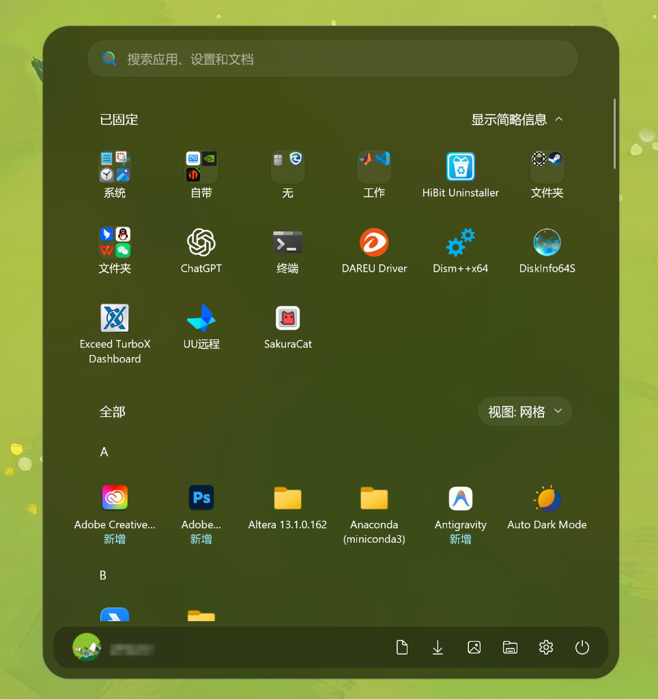

# LumiPill theme for Windows 11 Start Menu Styler

LumiPill is a dark/light adaptive translucent theme with a concentric pill
search box and bottom navigation bar, rounded app and folder tiles, and subtle
hover and press motion.

**Author**: [Eureka-o](https://github.com/Eureka-o)



## Notes

This theme was developed and tested on Windows 11 26H2. It is intended for the
Windows 11 Start Menu Styler mod and includes styles for the Start menu and the
SearchHost search surface. The theme follows the current light or dark Windows
theme automatically.

## Theme selection

The theme is integrated into the mod and can be selected directly from the
mod's settings:

* Open the Windows 11 Start Menu Styler mod in Windhawk.
* Go to the "Settings" tab.
* Select **LumiPill** as the theme and save the settings.

## Manual installation

The theme styles can also be imported manually. To do that, follow these steps:

* Open the Windows 11 Start Menu Styler mod in Windhawk.
* Go to the "Settings" tab and select "Textual mode".
* Copy the content below to the text box and click "Save settings".

<details>
<summary>Content to import (click to expand)</summary>

```yaml
styleConstants:
  - LumiGlass=<WindhawkBlur BlurAmount="30" TintColor="{ThemeResource SystemChromeMediumColor}" TintOpacity="0.55" TintLuminosityOpacity="0.40" NoiseOpacity="0.02" FallbackColor="{ThemeResource SystemChromeMediumColor}" />
  - LumiGlassSubtle=<WindhawkBlur BlurAmount="20" TintColor="{ThemeResource SystemChromeMediumColor}" TintOpacity="0.28" TintLuminosityOpacity="0.22" NoiseOpacity="0.015" FallbackColor="{ThemeResource SystemChromeMediumColor}" />
  - OuterRadius=30
  - CardRadius=20
  - PillRadius=18
  - TileRadius=14
  - OuterBorder={ThemeResource LumiStartOuterBorder}
  - InnerBorder={ThemeResource LumiStartInnerBorder}
  - CardBg={ThemeResource LumiStartCardBg}
  - PillBg={ThemeResource LumiStartPillBg}
  - PillHover={ThemeResource LumiStartPillHover}
  - PillPressed={ThemeResource LumiStartPillPressed}
  - TileHover={ThemeResource LumiStartTileHover}
  - TilePressed={ThemeResource LumiStartTilePressed}
  - HoverFade=<BrushTransition Duration="0:0:0.04" />
controlStyles:
  - target: Windows.UI.Xaml.Controls.Border#AcrylicBorder
    styles:
      - Background:=$LumiGlass
      - CornerRadius=$OuterRadius
      - BorderThickness=1
      - BorderBrush=$OuterBorder
  - target: Windows.UI.Xaml.Controls.Border#AcrylicOverlay
    styles:
      - Visibility=Collapsed
  - target: Windows.UI.Xaml.Controls.Border#StartDropShadow, Windows.UI.Xaml.Controls.Border#RootGridDropShadow, Windows.UI.Xaml.Controls.Border#DropShadow, Windows.UI.Xaml.Controls.Border#RightCompanionDropShadow, Windows.UI.Xaml.Controls.Border#dropshadow
    styles:
      - Visibility=Collapsed
  - target: StartMenu.StartMenuCompanion#RightCompanion > Windows.UI.Xaml.Controls.Grid#CompanionRoot > Windows.UI.Xaml.Controls.Border#AcrylicBorder
    styles:
      - Background:=$LumiGlass
      - CornerRadius=$OuterRadius
      - BorderThickness=1
      - BorderBrush=$OuterBorder
  - target: Cortana.UI.Views.TaskbarSearchPage > Windows.UI.Xaml.Controls.Grid#RootGrid > Windows.UI.Xaml.Controls.Grid#OuterBorderGrid
    styles:
      - CornerRadius=24
  - target: Windows.UI.Xaml.Controls.Border#AppBorder, Windows.UI.Xaml.Controls.Border#AccentAppBorder
    styles:
      - Background:=$LumiGlass
      - CornerRadius=24
      - BorderThickness=1
      - BorderBrush=$OuterBorder
      - BackgroundSizing=InnerBorderEdge
  - target: Windows.UI.Xaml.Controls.Border#LayerBorder, Windows.UI.Xaml.Controls.Border#AccentLayerBorder
    styles:
      - Opacity=0
  - target: Windows.UI.Xaml.Controls.Border#TaskbarSearchBackground
    styles:
      - Background=$PillBg
      - CornerRadius=20
      - BorderThickness=1
      - BorderBrush=$InnerBorder
      - BackgroundSizing=InnerBorderEdge
  - target: Windows.UI.Xaml.PopupRoot
    styles:
      - CornerRadius=$OuterRadius
  - target: Windows.UI.Xaml.Controls.Grid#NavPanePlaceholder
    styles:
      - Background:=$LumiGlassSubtle
      - BorderBrush=$InnerBorder
      - BorderThickness=1
      - CornerRadius=18
      - Height=48
      - Padding=8,0,8,0
      - Margin=12,6,12,12
      - BackgroundSizing=InnerBorderEdge
      - Canvas.ZIndex=10
  - target: StartDocked.NavigationPaneView#NavigationPane
    styles:
      - Margin=0
  - target: StartDocked.NavigationPaneButton#UserTileButton > Windows.UI.Xaml.Controls.Grid@CommonStates > Windows.UI.Xaml.Controls.Border#BackgroundBorder
    styles:
      - CornerRadius=14
      - BackgroundTransition:=<BrushTransition Duration="0:0:0" />
      - Background@Normal:=<SolidColorBrush Color="{ThemeResource SystemChromeAltHighColor}" Opacity="0.001" />
      - Background@PointerOver=$TileHover
      - Background@Pressed=$TilePressed
      - BorderThickness=0
      - BackgroundSizing=InnerBorderEdge
  - target: StartDocked.NavigationPaneButton#PowerButton > Windows.UI.Xaml.Controls.Grid@CommonStates > Windows.UI.Xaml.Controls.Border#BackgroundBorder
    styles:
      - CornerRadius=14
      - BackgroundTransition:=<BrushTransition Duration="0:0:0" />
      - Background@Normal:=<SolidColorBrush Color="{ThemeResource SystemChromeAltHighColor}" Opacity="0.001" />
      - Background@PointerOver=$TileHover
      - Background@Pressed=$TilePressed
      - BorderThickness=0
      - BackgroundSizing=InnerBorderEdge
  - target: StartMenu.SearchBoxToggleButton#SearchBoxToggleButton
    styles:
      - Margin=18,16,18,8
      - Height=40
  - target: StartMenu.SearchBoxToggleButton > Windows.UI.Xaml.Controls.Grid@CommonStates > Windows.UI.Xaml.Controls.Border#BorderElement
    styles:
      - CornerRadius=18
      - Background@Normal=$PillBg
      - Background@PointerOver=$PillHover
      - Background@Pressed=$PillPressed
      - BorderBrush=$InnerBorder
      - BorderThickness=1
      - BackgroundSizing=InnerBorderEdge
      - BackgroundTransition:=$HoverFade
  - target: StartDocked.SearchBoxToggleButton#StartMenuSearchBox > Windows.UI.Xaml.Controls.Grid@CommonStates > Windows.UI.Xaml.Controls.Border#BorderElement
    styles:
      - CornerRadius=18
      - Background@Normal=$PillBg
      - Background@PointerOver=$PillHover
      - Background@Pressed=$PillPressed
      - BorderBrush=$InnerBorder
      - BorderThickness=1
      - BackgroundSizing=InnerBorderEdge
      - BackgroundTransition:=$HoverFade
  - target: Windows.UI.Xaml.Controls.Border#BorderUnderline
    styles:
      - Visibility=Collapsed
  - target: Windows.UI.Xaml.Controls.Grid#TopLevelSuggestionsRoot, Windows.UI.Xaml.Controls.Grid#TopLevelSuggestionsListHeader, Windows.UI.Xaml.Controls.Grid#NoTopLevelSuggestionsText, Windows.UI.Xaml.Controls.Grid#TopLevelSuggestionsContainer, Windows.UI.Xaml.Controls.Grid#ShowMoreSuggestions, Windows.UI.Xaml.Controls.Grid#SuggestionsParentContainer
    styles:
      - Visibility=Collapsed
  - target: StartMenu.CategoryControl > Windows.UI.Xaml.Controls.Grid#RootGrid > Windows.UI.Xaml.Controls.Border
    styles:
      - CornerRadius=$CardRadius
      - Background=$CardBg
      - BorderBrush=$InnerBorder
      - BorderThickness=1
      - BackgroundSizing=InnerBorderEdge
  - target: Windows.UI.Xaml.Controls.Button#FolderPlate > Windows.UI.Xaml.Controls.Grid@CommonStates
    styles:
      - RenderTransformOrigin=0.5,0.5
      - RenderTransform:=<ScaleTransform ScaleX="1.0" ScaleY="1.0" />
      - RenderTransform@PointerOver:=<ScaleTransform ScaleX="1.03" ScaleY="1.03" />
      - RenderTransform@Pressed:=<ScaleTransform ScaleX="0.95" ScaleY="0.95" />
  - target: Windows.UI.Xaml.Controls.Button#FolderPlate > Windows.UI.Xaml.Controls.Grid@CommonStates > Windows.UI.Xaml.Controls.Border
    styles:
      - CornerRadius=12
      - Background@Normal=$CardBg
      - Background@PointerOver=$PillHover
      - Background@Pressed=$PillPressed
      - BorderBrush=$InnerBorder
      - BorderThickness=1
      - BackgroundSizing=InnerBorderEdge
      - BackgroundTransition:=$HoverFade
  - target: Windows.UI.Xaml.Controls.Border#FolderPlate
    styles:
      - CornerRadius=10
      - Background=$CardBg
      - BorderBrush=$InnerBorder
      - BorderThickness=1
      - BackgroundSizing=InnerBorderEdge
  - target: StartMenu.FolderModal#StartFolderModal > Windows.UI.Xaml.Controls.Grid#Root > Windows.UI.Xaml.Controls.Border, StartMenu.FolderModal > Windows.UI.Xaml.Controls.Grid#Root > Windows.UI.Xaml.Controls.Border
    styles:
      - Background:=$LumiGlass
      - CornerRadius=30
      - BorderThickness=1
      - BorderBrush=$OuterBorder
  - target: StartMenu.FolderModal#StartFolderModal > Windows.UI.Xaml.Controls.Grid#Root
    styles:
      - Height=Auto
      - Width=Auto
  - target: Windows.UI.Xaml.Controls.TextBox#MutableFolderNameTextBox > Windows.UI.Xaml.Controls.Grid@CommonStates > Windows.UI.Xaml.Controls.Border#BorderElement
    styles:
      - CornerRadius=14
      - Background=$PillBg
      - BorderBrush=$InnerBorder
      - BorderThickness=1
  - target: Windows.UI.Xaml.Controls.Border#ContentBorder@CommonStates > Windows.UI.Xaml.Controls.Grid > Windows.UI.Xaml.Controls.Border#BackgroundBorder
    styles:
      - CornerRadius=$TileRadius
      - BackgroundTransition:=<BrushTransition Duration="0:0:0" />
      - Background@Normal:=<SolidColorBrush Color="{ThemeResource SystemChromeAltHighColor}" Opacity="0.001" />
      - Background@PointerOver=$TileHover
      - Background@Pressed=$TilePressed
      - Background@Selected:=<SolidColorBrush Color="{ThemeResource SystemAccentColor}" Opacity="0.32" />
      - Background@SelectedPointerOver:=<SolidColorBrush Color="{ThemeResource SystemAccentColor}" Opacity="0.42" />
      - Background@PointerOverSelected:=<SolidColorBrush Color="{ThemeResource SystemAccentColor}" Opacity="0.42" />
      - Background@SelectedPressed:=<SolidColorBrush Color="{ThemeResource SystemAccentColor}" Opacity="0.50" />
      - Background@PressedSelected:=<SolidColorBrush Color="{ThemeResource SystemAccentColor}" Opacity="0.50" />
      - BorderThickness=0
      - BorderThickness@Selected=1
      - BorderBrush@Selected:=<SolidColorBrush Color="{ThemeResource SystemAccentColor}" Opacity="0.60" />
      - BackgroundSizing=InnerBorderEdge
  - target: Windows.UI.Xaml.Controls.ListViewItem > Windows.UI.Xaml.Controls.Grid@CommonStates > Windows.UI.Xaml.Controls.Border#BorderBackground
    styles:
      - CornerRadius=14
      - BackgroundTransition:=<BrushTransition Duration="0:0:0" />
      - Background@Normal:=<SolidColorBrush Color="{ThemeResource SystemChromeAltHighColor}" Opacity="0.001" />
      - Background@PointerOver=$TileHover
      - Background@Pressed=$TilePressed
      - Background@Selected:=<SolidColorBrush Color="{ThemeResource SystemAccentColor}" Opacity="0.32" />
      - Background@SelectedPointerOver:=<SolidColorBrush Color="{ThemeResource SystemAccentColor}" Opacity="0.42" />
      - Background@PointerOverSelected:=<SolidColorBrush Color="{ThemeResource SystemAccentColor}" Opacity="0.42" />
      - Background@SelectedPressed:=<SolidColorBrush Color="{ThemeResource SystemAccentColor}" Opacity="0.50" />
      - Background@PressedSelected:=<SolidColorBrush Color="{ThemeResource SystemAccentColor}" Opacity="0.50" />
      - BorderThickness=0
      - BorderThickness@Selected=1
      - BorderBrush@Selected:=<SolidColorBrush Color="{ThemeResource SystemAccentColor}" Opacity="0.60" />
      - BackgroundSizing=InnerBorderEdge
  - target: StartDocked.AppListViewItem > Windows.UI.Xaml.Controls.Grid@CommonStates > Windows.UI.Xaml.Controls.Border#BackgroundBorder
    styles:
      - CornerRadius=14
      - BackgroundTransition:=<BrushTransition Duration="0:0:0" />
      - Background@Normal:=<SolidColorBrush Color="{ThemeResource SystemChromeAltHighColor}" Opacity="0.001" />
      - Background@PointerOver=$TileHover
      - Background@Pressed=$TilePressed
      - Background@Selected:=<SolidColorBrush Color="{ThemeResource SystemAccentColor}" Opacity="0.32" />
      - Background@SelectedPointerOver:=<SolidColorBrush Color="{ThemeResource SystemAccentColor}" Opacity="0.42" />
      - Background@PointerOverSelected:=<SolidColorBrush Color="{ThemeResource SystemAccentColor}" Opacity="0.42" />
      - Background@SelectedPressed:=<SolidColorBrush Color="{ThemeResource SystemAccentColor}" Opacity="0.50" />
      - Background@PressedSelected:=<SolidColorBrush Color="{ThemeResource SystemAccentColor}" Opacity="0.50" />
      - BorderThickness=0
      - BorderThickness@Selected=1
      - BorderBrush@Selected:=<SolidColorBrush Color="{ThemeResource SystemAccentColor}" Opacity="0.60" />
      - BackgroundSizing=InnerBorderEdge
  - target: Windows.UI.Xaml.Controls.Primitives.ListViewItemPresenter
    styles:
      - CornerRadius=14
      - SelectedBackground:=<SolidColorBrush Color="{ThemeResource SystemAccentColor}" Opacity="0.32" />
      - SelectedPointerOverBackground:=<SolidColorBrush Color="{ThemeResource SystemAccentColor}" Opacity="0.42" />
      - SelectedPressedBackground:=<SolidColorBrush Color="{ThemeResource SystemAccentColor}" Opacity="0.50" />
      - PointerOverBackground=$TileHover
      - PressedBackground=$TilePressed
  - target: Windows.UI.Xaml.Controls.Border#ContentBorder@CommonStates > Windows.UI.Xaml.Controls.Grid#DroppedFlickerWorkaroundWrapper > Windows.UI.Xaml.Controls.ContentPresenter#ContentPresenter > Windows.UI.Xaml.Controls.ContentControl > Windows.UI.Xaml.Controls.Grid#RootGrid > Windows.UI.Xaml.Controls.Border#LogoBackgroundPlate > Windows.UI.Xaml.Controls.Image#AllAppsItemLogo
    styles:
      - RenderTransformOrigin=0.5,0.5
      - RenderTransform:=<ScaleTransform ScaleX="1.0" ScaleY="1.0" />
      - RenderTransform@Pressed:=<ScaleTransform ScaleX="0.92" ScaleY="0.92" />
  - target: Windows.UI.Xaml.Controls.Border#ContentBorder@CommonStates > Windows.UI.Xaml.Controls.Grid#DroppedFlickerWorkaroundWrapper > Windows.UI.Xaml.Controls.ContentPresenter#ContentPresenter > Windows.UI.Xaml.Controls.ContentControl > Windows.UI.Xaml.Controls.Grid#RootGrid > Windows.UI.Xaml.Controls.Grid#LogoContainer > Windows.UI.Xaml.Controls.Image#AllAppsTileLogo
    styles:
      - RenderTransformOrigin=0.5,0.5
      - RenderTransform:=<ScaleTransform ScaleX="1.0" ScaleY="1.0" />
      - RenderTransform@Pressed:=<ScaleTransform ScaleX="0.92" ScaleY="0.92" />
  - target: Windows.UI.Xaml.Controls.Border#ContentBorder@CommonStates > Windows.UI.Xaml.Controls.Grid#DroppedFlickerWorkaroundWrapper > Windows.UI.Xaml.Controls.ContentPresenter > Windows.UI.Xaml.Controls.Grid > Windows.UI.Xaml.Controls.Grid#LogoContainer > Windows.UI.Xaml.Controls.Grid
    styles:
      - RenderTransformOrigin=0.5,0.5
      - RenderTransform:=<ScaleTransform ScaleX="1.0" ScaleY="1.0" />
      - RenderTransform@Pressed:=<ScaleTransform ScaleX="0.92" ScaleY="0.92" />
  - target: Microsoft.UI.Xaml.Controls.DropDownButton#ViewSelectionButton > Windows.UI.Xaml.Controls.Grid@CommonStates
    styles:
      - CornerRadius=16
      - Background@Normal=$PillBg
      - Background@PointerOver=$PillHover
      - Background@Pressed=$PillPressed
      - BorderBrush=$InnerBorder
      - BorderThickness=1
      - BackgroundTransition:=$HoverFade
  - target: Windows.UI.Xaml.Controls.Button#ShowAllAppsButton > Windows.UI.Xaml.Controls.Grid@CommonStates > Windows.UI.Xaml.Controls.Border#BackgroundBorder, Windows.UI.Xaml.Controls.Button#CloseAllAppsButton > Windows.UI.Xaml.Controls.Grid@CommonStates > Windows.UI.Xaml.Controls.Border#BackgroundBorder, Windows.UI.Xaml.Controls.Button#ShowMorePinnedButton > Windows.UI.Xaml.Controls.Grid@CommonStates > Windows.UI.Xaml.Controls.Border#BackgroundBorder
    styles:
      - CornerRadius=16
      - Background@Normal=$PillBg
      - Background@PointerOver=$PillHover
      - Background@Pressed=$PillPressed
      - BorderBrush=$InnerBorder
      - BorderThickness=1
      - BackgroundTransition:=$HoverFade
  - target: Windows.UI.Xaml.Controls.Primitives.ToggleButton#ShowHideCompanion > Windows.UI.Xaml.Controls.Border > Windows.UI.Xaml.Controls.ContentPresenter#ContentPresenter
    styles:
      - CornerRadius=18
  - target: Windows.UI.Xaml.Controls.MenuFlyoutPresenter
    styles:
      - CornerRadius=22
      - Background=Transparent
      - BorderThickness=0
  - target: Windows.UI.Xaml.Controls.MenuFlyoutPresenter > Windows.UI.Xaml.Controls.Border
    styles:
      - CornerRadius=22
      - Background:=$LumiGlass
      - BorderThickness=1
      - BorderBrush=$OuterBorder
      - Padding=6
  - target: Windows.UI.Xaml.Controls.MenuFlyoutPresenter > Windows.UI.Xaml.Controls.Border > Windows.UI.Xaml.Controls.ScrollViewer
    styles:
      - CornerRadius=22
  - target: Windows.UI.Xaml.Controls.MenuFlyoutItem, Windows.UI.Xaml.Controls.ToggleMenuFlyoutItem
    styles:
      - CornerRadius=12
      - Margin=2
  - target: Windows.UI.Xaml.Controls.ToolTip > Windows.UI.Xaml.Controls.ContentPresenter#LayoutRoot
    styles:
      - Background:=$LumiGlass
      - BorderBrush=$InnerBorder
      - BorderThickness=1
      - CornerRadius=14
  - target: Windows.UI.Xaml.Controls.FlyoutPresenter
    styles:
      - CornerRadius=26
      - BorderThickness=0
  - target: Windows.UI.Xaml.Controls.FlyoutPresenter > Windows.UI.Xaml.Controls.Border
    styles:
      - CornerRadius=26
      - Background:=$LumiGlass
      - BorderThickness=1
      - BorderBrush=$OuterBorder
themeResourceVariables:
  - LumiStartOuterBorder@Light:=<LinearGradientBrush StartPoint="0,0" EndPoint="0,1"><GradientStop Color="#58FFFFFF" Offset="0.0" /><GradientStop Color="#16000000" Offset="0.45" /><GradientStop Color="#2B000000" Offset="1.0" /></LinearGradientBrush>
  - LumiStartOuterBorder@Dark:=<LinearGradientBrush StartPoint="0,0" EndPoint="0,1"><GradientStop Color="#3CFFFFFF" Offset="0.0" /><GradientStop Color="#14FFFFFF" Offset="0.45" /><GradientStop Color="#26000000" Offset="1.0" /></LinearGradientBrush>
  - LumiStartInnerBorder@Light:=<LinearGradientBrush StartPoint="0,0" EndPoint="0,1"><GradientStop Color="#48FFFFFF" Offset="0.0" /><GradientStop Color="#12000000" Offset="0.50" /><GradientStop Color="#1E000000" Offset="1.0" /></LinearGradientBrush>
  - LumiStartInnerBorder@Dark:=<LinearGradientBrush StartPoint="0,0" EndPoint="0,1"><GradientStop Color="#2CFFFFFF" Offset="0.0" /><GradientStop Color="#0DFFFFFF" Offset="0.50" /><GradientStop Color="#18000000" Offset="1.0" /></LinearGradientBrush>
  - LumiStartCardBg@Light:=<SolidColorBrush Color="#38FFFFFF" />
  - LumiStartCardBg@Dark:=<SolidColorBrush Color="#18FFFFFF" />
  - LumiStartPillBg@Light:=<SolidColorBrush Color="#4AFFFFFF" />
  - LumiStartPillBg@Dark:=<SolidColorBrush Color="#20FFFFFF" />
  - LumiStartPillHover@Light:=<SolidColorBrush Color="#68FFFFFF" />
  - LumiStartPillHover@Dark:=<SolidColorBrush Color="#30FFFFFF" />
  - LumiStartPillPressed@Light:=<SolidColorBrush Color="#2EFFFFFF" />
  - LumiStartPillPressed@Dark:=<SolidColorBrush Color="#12FFFFFF" />
  - LumiStartTileHover@Light:=<SolidColorBrush Color="#46FFFFFF" />
  - LumiStartTileHover@Dark:=<SolidColorBrush Color="#24FFFFFF" />
  - LumiStartTilePressed@Light:=<SolidColorBrush Color="#26FFFFFF" />
  - LumiStartTilePressed@Dark:=<SolidColorBrush Color="#14FFFFFF" />
```
</details>
