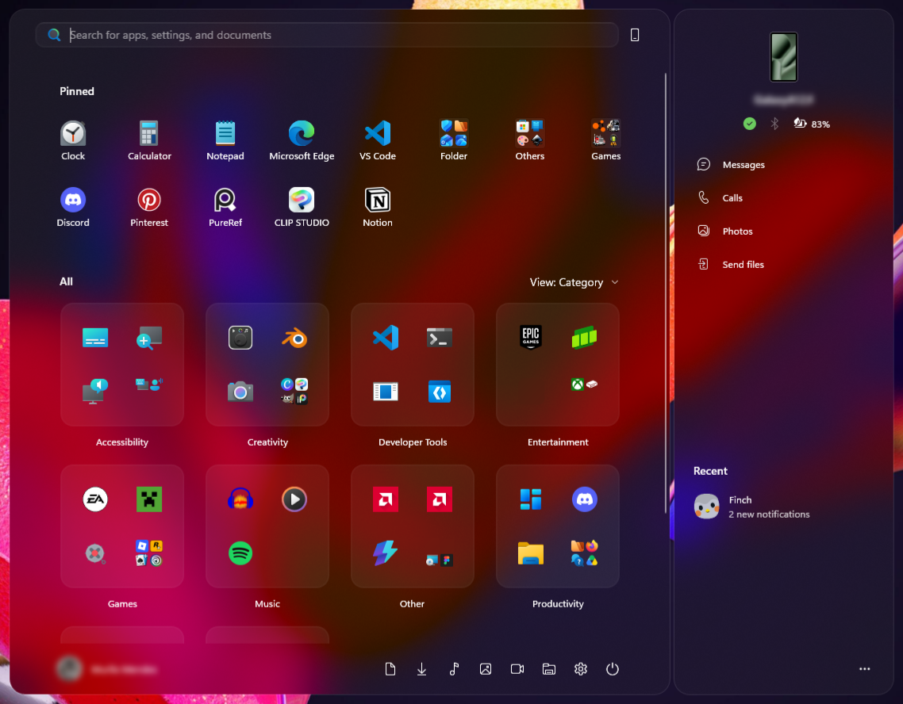

# Luminosity theme for Windows 11 Start Menu Styler

**Author**: [mendes.image](https://github.com/mendesimage)



## Intro

**Luminosity** is inspired on native Acrylic, using the maximum **TintLuminosityOpacity** value as its backdrop.

It's meant to be used with **Mica** or **MicaAlt** backdrops, I recommend the **Translucent Windows** mod.

> [!NOTE]
> This theme is designed primarily for the [redesigned Windows 11 Start menu](https://microsoft.design/articles/start-fresh-redesigning-windows-start-menu/) that is available on version 24H2 and later, with partial styling for the classic one.

<br>

## General Information

The theme changes the following things:

<Details>
<summary>(click to expand)</summary>

- Start Menu
	- Background
	- Main Page
	- Folders
  	- All Apps layout switch animation
	- Uninstall Pop-up
	- Right Companion / Phone Link
	- Account Pop-up (basic styling)
- Search Menu
	- Background
	- Search box
- Adds effects to many buttons and text boxes
- Jump lists (basic styling)
- Right-Click Menu
- Right-Click Menu Entrance animations
- Tooltips
- Removes drop shadows

</details>

## Guides

**Visual Mode** and **Textual Mode** refer to which mode your **Settings** tab is set to. These guides are mostly for **theme selection through the Styler mod**. If you're using a **manual installation**, you may need to adapt the instructions: search for the referenced target in your installation, then edit or remove things as needed.

### Custom Background

<details>
<summary>(Click to expand guide)</summary>

<br>

Edit these Style constants:

- `lumiBackground` -- Main Background
- `lumiBackground2` -- Folders and Uninstall Pop-up Background

**Default values:**

`lumiBackground`

```yaml
<WindhawkBlur BlurAmount="30" TintColor="{ThemeResource CardStrokeColorDefaultSolid}" TintOpacity="0.0" TintLuminosityOpacity="1.0" TintSaturation="1.0" NoiseDensity="1.0" NoiseOpacity="0.1" />
```

`lumiBackground2`

```yaml
<WindhawkBlur BlurAmount="15" TintColor="#00000000" />
```

<br>

#### Visual Mode

In **Style Constants**, paste:

```txt
lumiBackground=<WindhawkBlur BlurAmount="30" TintColor="{ThemeResource CardStrokeColorDefaultSolid}" TintOpacity="0.0" TintLuminosityOpacity="1.0" TintSaturation="1.0" NoiseDensity="1.0" NoiseOpacity="0.1" />
```

And / or:

```txt
lumiBackground2=<WindhawkBlur BlurAmount="15" TintColor="#00000000" />
```

And edit it.

---

#### Textual Mode

Anywhere under `styleConstants:`, paste:

```yaml
  - lumiBackground=<WindhawkBlur BlurAmount="30" TintColor="{ThemeResource CardStrokeColorDefaultSolid}" TintOpacity="0.0" TintLuminosityOpacity="1.0" TintSaturation="1.0" NoiseDensity="1.0" NoiseOpacity="0.1" />
```

And / or:

```yaml
  - lumiBackground2=<WindhawkBlur BlurAmount="15" TintColor="#00000000" />
```

And... edit it.

</details>

<br>

### Faster Right-Click Menu Animation

<details>
<summary>(Click to expand guide)</summary>

<br>

**Note:** This doesn't fully disable all menu animations.

Set the style constant `MenuAnimation` to `False`.

**Default value:** `True`

#### Visual Mode

In **Style Constants**, paste:

```txt
MenuAnimation=False
```

---

#### Textual Mode

Anywhere under `styleConstants:`, paste:

```yaml
  - MenuAnimation=False
```

</details>

<br>

### Change Button Fade Speed

<details>
<summary>(Click to expand guide)</summary>

<br>

Edit the style constant `FadeSpeed`. Its value is a duration in `hours:minutes:seconds` format.

**Default value:** `0:0:0.200` (200 milliseconds)

#### Visual Mode

In **Style Constants**, paste:

```txt
FadeSpeed=0:0:0.200
```

And edit its value.

---

#### Textual Mode

Anywhere under `styleConstants:`, paste:

```yaml
  - FadeSpeed=0:0:0.200
```

And... edit its value.

</details>

<br>

## Known Issues

I didn't know how to fix these. I couldn't find the correct target names, or I'm not sure if they can even be changed / fixed.

- **Account Pop-up:** Buttons doesn't match the theme.
- **Jump lists:** Jump lists (e.g. Right-click on File Explorer button) don't feature animations.
- **Search Menu**
	- All search UI doesn't match the theme.
- **Old Start Menu**
	- Buttons inside All Apps list might not match the theme.
	- Right Companion / Phone Link "Send Files" button might not match the theme.

<br>

## Theme selection

The theme is integrated into the mod and can be selected directly from the mod's settings:

* Open the Windows 11 Start Menu Styler mod in Windhawk.
* Go to the "Settings" tab.
* Select the theme and save the settings.

## Manual installation

The theme styles can also be imported manually. To do that, follow these steps:

* Open the Windows 11 Start Menu Styler mod in Windhawk.
* Go to the "Settings" tab and select "Textual mode".
* Copy the content below to the text box and click "Save settings".

---

<details>
<summary>Content to import (click to expand)</summary>

```yaml
styleConstants:
# General Settings
  - MenuAnimation=True
  - FadeSpeed=0:0:0.200
  - lumiBackground=<WindhawkBlur BlurAmount="30" TintColor="{ThemeResource CardStrokeColorDefaultSolid}" TintOpacity="0.0" TintLuminosityOpacity="1.0" TintSaturation="1.0" NoiseDensity="1.0" NoiseOpacity="0.1" />
  - lumiBackground2=<WindhawkBlur BlurAmount="15" TintColor="#00000000" />
  - lumiAccentColor=<SolidColorBrush Color="{ThemeResource LumiAccent}" />
  - wcr=20
  - mcr=15
  - bcr=10
  - t=Transparent
  - bb=#20FFFFFF
  - bt=1
  - bbb=<LinearGradientBrush x:Key="ShellTaskbarItemGradientStrokeColorSecondaryBrush" MappingMode="Absolute" StartPoint="0,0" EndPoint="0,3"><LinearGradientBrush.GradientStops><GradientStop Offset="0.33" Color="#1AFFFFFF" /><GradientStop Offset="1" Color="#0FFFFFFF" /></LinearGradientBrush.GradientStops></LinearGradientBrush>
  - bbt=2
  - bso=<SolidColorBrush Color="{ThemeResource ControlFillColorDefault}" />
  - bn=Transparent
  - bh=<SolidColorBrush Color="{ThemeResource ControlFillColorSecondary}" />
  - bp=<SolidColorBrush Color="{ThemeResource ControlFillColorTertiary}" />
controlStyles:
# =====================================
# HOW TO NAVIGATE THIS FILE           |
#                                     |
# 1. # Target Name / Description      |
# 2. # NOTE: Additional Information   |
# 3. Target and Styling               |
# (Target always below Name and Note) |
#                                     |
# That's all! :3                      |
# =====================================
# Start Menu Drop Shadow
  - target: Border#StartDropShadow, Border#RootGridDropShadow
    styles:
      - CornerRadius=$wcr
      - Visibility=Collapsed
# Start Menu And Phone Link / Right Companion Background and Border
  - target: Border#AcrylicBorder
    styles:
      - Background:=$lumiBackground
      - CornerRadius=$wcr
      - BorderThickness=$bt
      - BorderBrush=$bb
# Start Menu And Phone Link / Right Companion Background Overlay 
  - target: Border#AcrylicOverlay
    styles:
      - Visibility=Collapsed
# Start Menu Search Box / Search Bar
  - target: StartMenu.SearchBoxToggleButton#SearchBoxToggleButton > Grid@CommonStates > Border#BorderElement, StartDocked.SearchBoxToggleButton#StartMenuSearchBox > Grid@CommonStates > Border#BorderElement
    styles:
      - CornerRadius=$bcr
      - Background@Checked:=$bp
      - Background@CheckedPointerOver:=$bh
      - Background@CheckedPressed:=$bp
      - Background@CheckedDisabled:=$bn
      - Background@Normal:=$bn
      - Background@PointerOver:=$bh
      - Background@Pressed:=$bp
      - Background@Disabled:=$bn
      - BorderThickness=$bbt
      - BorderBrush@Checked:=$bbb
      - BorderBrush@CheckedPointerOver:=$bbb
      - BorderBrush@CheckedPressed:=$bbb
      - BorderBrush@CheckedDisabled:=$bn
      - BorderBrush@Normal:=$bn
      - BorderBrush@PointerOver:=$bbb
      - BorderBrush@Pressed:=$bbb
      - BorderBrush@Disabled:=$bn
      - BackgroundSizing=InnerBorderEdge
      - BackgroundTransition:=<BrushTransition Duration="$FadeSpeed" />
# Phone Link / Right Companion Toggle Button Original Background
# Note: Button styling didn't work very well here, so I've removed it.
  - target: Windows.UI.Xaml.Controls.Primitives.ToggleButton#ShowHideCompanion > Border@CommonStates > ContentPresenter
    styles:
      - Background:=$t
      - BorderThickness=0
      - BorderBrush:=$t
# Phone Link / Right Companion Toggle Button Effects
  - target: Windows.UI.Xaml.Controls.Primitives.ToggleButton#ShowHideCompanion > Border@CommonStates
    styles:
      - Margin=-1
      - CornerRadius=$bcr
      - Background@Normal:=$bn
      - Background@PointerOver:=$bh
      - Background@Pressed:=$bp
      - Background@Disabled:=$bn
      - Background@Checked:=$bn
      - Background@CheckedPointerOver:=$bh
      - Background@CheckedPressed:=$bp
      - Background@CheckedDisabled:=$bn
      - BorderThickness=$bbt
      - BorderBrush@Normal:=$bn
      - BorderBrush@PointerOver:=$bbb
      - BorderBrush@Pressed:=$bbb
      - BorderBrush@Disabled:=$bn
      - BorderBrush@Checked:=$bn
      - BorderBrush@CheckedPointerOver:=$bbb
      - BorderBrush@CheckedPressed:=$bbb
      - BorderBrush@CheckedDisabled:=$bn
      - BackgroundSizing=InnerBorderEdge
      - BackgroundTransition:=<BrushTransition Duration="$FadeSpeed" />
# Show All Apps / Show Less Apps Button
  - target: Grid#ShowMorePinnedGrid > Button > Grid@CommonStates > Border#BackgroundBorder
    styles:
      - CornerRadius=$bcr
      - Background@Normal:=$bn
      - Background@PointerOver:=$bh
      - Background@Pressed:=$bp
      - BorderThickness=$bbt
      - BorderBrush@Normal:=$bn
      - BorderBrush@PointerOver:=$bbb
      - BorderBrush@Pressed:=$bbb
      - BackgroundSizing=InnerBorderEdge
      - BackgroundTransition:=<BrushTransition Duration="$FadeSpeed" />
# Old Show All Apps Button (hopefully)
  - target: Button#ShowAllAppsButton > ContentPresenter#ContentPresenter@CommonStates
    styles:
      - CornerRadius=$bcr
      - Background@Normal:=$bn
      - Background@PointerOver:=$bh
      - Background@Pressed:=$bp
      - BorderThickness=$bbt
      - BorderBrush@Normal:=$bn
      - BorderBrush@PointerOver:=$bbb
      - BorderBrush@Pressed:=$bbb
      - BackgroundSizing=InnerBorderEdge
      - BackgroundTransition:=<BrushTransition Duration="$FadeSpeed" />
# Old Close All Apps Button (hopefully)
  - target: Button#CloseAllAppsButton > ContentPresenter#ContentPresenter@CommonStates
    styles:
      - CornerRadius=$bcr
      - Background@Normal:=$bn
      - Background@PointerOver:=$bh
      - Background@Pressed:=$bp
      - BorderThickness=$bbt
      - BorderBrush@Normal:=$bn
      - BorderBrush@PointerOver:=$bbb
      - BorderBrush@Pressed:=$bbb
      - BackgroundSizing=InnerBorderEdge
      - BackgroundTransition:=<BrushTransition Duration="$FadeSpeed" />
# Program Buttons / Program Icon / Pinned Icons Buttons
# NOTE: Affects Pinned items, Folders and All Apps view. 
  - target: Border#ContentBorder@CommonStates > Grid > Border#BackgroundBorder
    styles:
      - CornerRadius=$mcr
      - Background@Normal:=$bn
      - Background@PointerOver:=$bh
      - Background@Pressed:=$bp
      - BorderThickness=$bbt
      - BorderBrush@Normal:=$bn
      - BorderBrush@PointerOver:=$bbb
      - BorderBrush@Pressed:=$bbb
      - BackgroundSizing=InnerBorderEdge
      - BackgroundTransition:=<BrushTransition Duration="$FadeSpeed" />
# Folder / Expanded Category Background and Border
  - target: StartMenu.FolderModal#StartFolderModal > Grid#Root > Border, StartMenu.ExpandedFolderList > Grid#Root > Border
    styles:
      - Background:=$lumiBackground2
      - CornerRadius=$wcr
      - BorderThickness=$bt
      - BorderBrush=$bb
      - Shadow:=
# Folder Text Box
  - target: TextBox#MutableFolderNameTextBox > Grid@CommonStates > Border, TextBox#ExpandedFolderNameTextBox > Grid@CommonStates > Border
    styles:
      - CornerRadius=$mcr
      - Background@Normal:=$bn
      - Background@PointerOver:=$bh
      - Background@Pressed:=$bp
      - Background@Focused:=$bp
      - BorderThickness=$bbt
      - BorderBrush@Normal:=$bn
      - BorderBrush@PointerOver:=$bbb
      - BorderBrush@Pressed:=$bbb
      - BorderBrush@Focused:=$bbb
      - BackgroundSizing=InnerBorderEdge
      - BackgroundTransition:=<BrushTransition Duration="$FadeSpeed" />
# Show More Suggestions Button
  - target: Button#ShowMoreSuggestionsButton > Grid@CommonStates > Border#BackgroundBorder
    styles:
      - CornerRadius=$bcr
      - Background@Normal:=$bn
      - Background@PointerOver:=$bh
      - Background@Pressed:=$bp
      - BorderThickness=$bbt
      - BorderBrush@Normal:=$bn
      - BorderBrush@PointerOver:=$bbb
      - BorderBrush@Pressed:=$bbb
      - BackgroundSizing=InnerBorderEdge
      - BackgroundTransition:=<BrushTransition Duration="$FadeSpeed" />
# Hide More Suggestions Button
  - target: Button#HideMoreSuggestionsButton > Grid@CommonStates > Border#BackgroundBorder
    styles:
      - CornerRadius=$bcr
      - Background@Normal:=$bn
      - Background@PointerOver:=$bh
      - Background@Pressed:=$bp
      - BorderThickness=$bbt
      - BorderBrush@Normal:=$bn
      - BorderBrush@PointerOver:=$bbb
      - BorderBrush@Pressed:=$bbb
      - BackgroundSizing=InnerBorderEdge
      - BackgroundTransition:=<BrushTransition Duration="$FadeSpeed" />
# Hide More Suggestions Arrow Symbol Fix (Old Start Menu)
  - target: Windows.UI.Xaml.Controls.Button#HideMoreSuggestionsButton > Windows.UI.Xaml.Controls.ContentPresenter#ContentPresenter > Windows.UI.Xaml.Controls.StackPanel > Windows.UI.Xaml.Controls.FontIcon > Windows.UI.Xaml.Controls.Grid > Windows.UI.Xaml.Controls.TextBlock
    styles:
      - RenderTransform:=<ScaleTransform ScaleX="0.76" ScaleY="0.76" />
      - Margin=0,5,0,0
# Suggestion 1
# NOTE: First target is inside "Show all" (suggestions) button, 24h2. Third target is a guess for old Start Menu (23h2 and older).
  - target: ListViewItem#RecommendedItemRoot0 > Grid@CommonStates > Border#BorderBackground, GridViewItem#RecommendedItemRoot0 > Border@CommonStates > Grid > Border#BackgroundBorder
    styles:
      - CornerRadius=$mcr
      - Background@Normal:=$bn
      - Background@PointerOver:=$bh
      - Background@Pressed:=$bp
      - BorderThickness=$bbt
      - BorderBrush@Normal:=$bn
      - BorderBrush@PointerOver:=$bbb
      - BorderBrush@Pressed:=$bbb
      - BackgroundSizing=InnerBorderEdge
      - BackgroundTransition:=<BrushTransition Duration="$FadeSpeed" />
# Suggestion 2 (hopefully)
# NOTE: First target is inside "Show all" (suggestions) button, 24h2. Third target is a guess for old Start Menu (23h2 and older)
  - target: ListViewItem#RecommendedItemRoot1 > Grid@CommonStates > Border#BorderBackground, GridViewItem#RecommendedItemRoot1 > Border@CommonStates > Grid > Border#BackgroundBorder
      - CornerRadius=$mcr
      - Background@Normal:=$bn
      - Background@PointerOver:=$bh
      - Background@Pressed:=$bp
      - BorderThickness=$bbt
      - BorderBrush@Normal:=$bn
      - BorderBrush@PointerOver:=$bbb
      - BorderBrush@Pressed:=$bbb
      - BackgroundSizing=InnerBorderEdge
      - BackgroundTransition:=<BrushTransition Duration="$FadeSpeed" />
# Suggestion 3 (hopefully)
# NOTE: First target is inside "Show all" (suggestions) button, 24h2. Third target is a guess for old Start Menu (23h2 and older)
  - target: ListViewItem#RecommendedItemRoot2 > Grid@CommonStates > Border#BorderBackground, GridViewItem#RecommendedItemRoot2 > Border@CommonStates > Grid > Border#BackgroundBorder
    styles:
      - CornerRadius=$mcr
      - Background@Normal:=$bn
      - Background@PointerOver:=$bh
      - Background@Pressed:=$bp
      - BorderThickness=$bbt
      - BorderBrush@Normal:=$bn
      - BorderBrush@PointerOver:=$bbb
      - BorderBrush@Pressed:=$bbb
      - BackgroundSizing=InnerBorderEdge
      - BackgroundTransition:=<BrushTransition Duration="$FadeSpeed" />
# Suggestion 4 (hopefully)
# NOTE: First target is inside "Show all" (suggestions) button, 24h2. Third target is a guess for old Start Menu (23h2 and older)
  - target: ListViewItem#RecommendedItemRoot3 > Grid@CommonStates > Border#BorderBackground, GridViewItem#RecommendedItemRoot3 > Border@CommonStates > Grid > Border#BackgroundBorder
    styles:
      - CornerRadius=$mcr
      - Background@Normal:=$bn
      - Background@PointerOver:=$bh
      - Background@Pressed:=$bp
      - BorderThickness=$bbt
      - BorderBrush@Normal:=$bn
      - BorderBrush@PointerOver:=$bbb
      - BorderBrush@Pressed:=$bbb
      - BackgroundSizing=InnerBorderEdge
      - BackgroundTransition:=<BrushTransition Duration="$FadeSpeed" />
# Suggestion 5 (hopefully)
# NOTE: First target is inside "Show all" (suggestions) button, 24h2. Third target is a guess for old Start Menu (23h2 and older)
  - target: ListViewItem#RecommendedItemRoot4 > Grid@CommonStates > Border#BorderBackground, GridViewItem#RecommendedItemRoot4 > Border@CommonStates > Grid > Border#BackgroundBorder
    styles:
      - CornerRadius=$mcr
      - Background@Normal:=$bn
      - Background@PointerOver:=$bh
      - Background@Pressed:=$bp
      - BorderThickness=$bbt
      - BorderBrush@Normal:=$bn
      - BorderBrush@PointerOver:=$bbb
      - BorderBrush@Pressed:=$bbb
      - BackgroundSizing=InnerBorderEdge
      - BackgroundTransition:=<BrushTransition Duration="$FadeSpeed" />
# Suggestion 6 (hopefully)
# NOTE: First target is inside "Show all" (suggestions) button, 24h2. Third target is a guess for old Start Menu (23h2 and older)
  - target: ListViewItem#RecommendedItemRoot5 > Grid@CommonStates > Border#BorderBackground, GridViewItem#RecommendedItemRoot5 > Border@CommonStates > Grid > Border#BackgroundBorder
    styles:
      - CornerRadius=$mcr
      - Background@Normal:=$bn
      - Background@PointerOver:=$bh
      - Background@Pressed:=$bp
      - BorderThickness=$bbt
      - BorderBrush@Normal:=$bn
      - BorderBrush@PointerOver:=$bbb
      - BorderBrush@Pressed:=$bbb
      - BackgroundSizing=InnerBorderEdge
      - BackgroundTransition:=<BrushTransition Duration="$FadeSpeed" />
# Suggestion 7 (hopefully)
# NOTE: First target is inside "Show all" (suggestions) button, 24h2. Third target is a guess for old Start Menu (23h2 and older)
  - target: ListViewItem#RecommendedItemRoot6 > Grid@CommonStates > Border#BorderBackground, GridViewItem#RecommendedItemRoot6 > Border@CommonStates > Grid > Border#BackgroundBorder
    styles:
      - CornerRadius=$mcr
      - Background@Normal:=$bn
      - Background@PointerOver:=$bh
      - Background@Pressed:=$bp
      - BorderThickness=$bbt
      - BorderBrush@Normal:=$bn
      - BorderBrush@PointerOver:=$bbb
      - BorderBrush@Pressed:=$bbb
      - BackgroundSizing=InnerBorderEdge
      - BackgroundTransition:=<BrushTransition Duration="$FadeSpeed" />
# Suggestion 8 (hopefully)
# NOTE: First target is inside "Show all" (suggestions) button, 24h2. Third target is a guess for old Start Menu (23h2 and older)
  - target: ListViewItem#RecommendedItemRoot7 > Grid@CommonStates > Border#BorderBackground, GridViewItem#RecommendedItemRoot7 > Border@CommonStates > Grid > Border#BackgroundBorder
    styles:
      - CornerRadius=$mcr
      - Background@Normal:=$bn
      - Background@PointerOver:=$bh
      - Background@Pressed:=$bp
      - BorderThickness=$bbt
      - BorderBrush@Normal:=$bn
      - BorderBrush@PointerOver:=$bbb
      - BorderBrush@Pressed:=$bbb
      - BackgroundSizing=InnerBorderEdge
      - BackgroundTransition:=<BrushTransition Duration="$FadeSpeed" />
# View Options Drop Down Button
  - target: Grid#AllListHeading > Microsoft.UI.Xaml.Controls.DropDownButton#ViewSelectionButton > Grid#RootGrid@CommonStates
    styles:
      - CornerRadius=$bcr
      - Background@Normal:=$bn
      - Background@PointerOver:=$bh
      - Background@Pressed:=$bp
      - Background@Disabled:=$bn
      - BorderThickness=$bbt
      - BorderBrush@Normal:=$bn
      - BorderBrush@PointerOver:=$bbb
      - BorderBrush@Pressed:=$bbb
      - BorderBrush@Disabled:=$bn
      - BackgroundSizing=InnerBorderEdge
      - BackgroundTransition:=<BrushTransition Duration="$FadeSpeed" />
# View Options Drop Down Items
# Note: Its floyut background is `MenuFlyoutPresenter > Border` further down the YAML.
  - target: ToggleMenuFlyoutItem > Grid@CommonStates
    styles:
      - CornerRadius=$bcr
      - BackgroundTransition:=<BrushTransition Duration="$FadeSpeed" />
# Category Background
  - target: StartMenu.CategoryControl > Grid#RootGrid > Border
    styles:
      - CornerRadius=$mcr
      - Background:=$bso
      - BorderThickness=$bbt
      - BorderBrush:=$bh
      - BackgroundSizing=InnerBorderEdge
      - BackgroundTransition:=<BrushTransition Duration="$FadeSpeed" />
# Category Item
  - target: Button#LogoContainer > Grid@CommonStates > Border#BackgroundBorder
    styles:
      - CornerRadius=$bcr
      - Background@Normal:=$bn
      - Background@PointerOver:=$bh
      - Background@Pressed:=$bp
      - Background@Disabled:=$bn
      - BorderThickness=$bbt
      - BorderBrush@Normal:=$bn
      - BorderBrush@PointerOver:=$bbb
      - BorderBrush@Pressed:=$bbb
      - BorderBrush@Disabled:=$bn
      - BackgroundSizing=InnerBorderEdge
      - BackgroundTransition:=<BrushTransition Duration="$FadeSpeed" />
# Category Folder-Looking Item that opens category :3
  - target: Button#FolderPlate > Grid@CommonStates > Border#BackgroundBorder
    styles:
      - CornerRadius=$bcr
      - Background@Normal:=$bn
      - Background@PointerOver:=$bh
      - Background@Pressed:=$bp
      - Background@Disabled:=$bn
      - BorderThickness=$bbt
      - BorderBrush@Normal:=$bn
      - BorderBrush@PointerOver:=$bbb
      - BorderBrush@Pressed:=$bbb
      - BorderBrush@Disabled:=$bn
      - BackgroundSizing=InnerBorderEdge
      - BackgroundTransition:=<BrushTransition Duration="$FadeSpeed" />
# Category Title
  - target: Button#SeeAllButton > Grid@CommonStates > Border#BackgroundBorder
    styles:
      - CornerRadius=$bcr
      - Background@Normal:=$bn
      - Background@PointerOver:=$bh
      - Background@Pressed:=$bp
      - Background@Disabled:=$bn
      - BorderThickness=$bbt
      - BorderBrush@Normal:=$bn
      - BorderBrush@PointerOver:=$bbb
      - BorderBrush@Pressed:=$bbb
      - BorderBrush@Disabled:=$bn
      - BackgroundSizing=InnerBorderEdge
      - BackgroundTransition:=<BrushTransition Duration="$FadeSpeed" />
# Group Inside Category Back Button
  - target: StartMenu.FolderModal#StartFolderModal > Grid#Root > ContentControl#ContentControl > ContentPresenter > StartMenu.UniversalTileContainer#UniversalTileContainer > Grid#GridViewContainer > Grid#FolderLabels > Button#GoToLevelOneButton > Grid@CommonStates > Border#BackgroundBorder
    styles:
      - Margin=-2
      - CornerRadius=$mcr
      - Background@Normal:=$bn
      - Background@PointerOver:=$bh
      - Background@Pressed:=$bp
      - BorderThickness=$bbt
      - BorderBrush@Normal:=$bn
      - BorderBrush@PointerOver:=$bbb
      - BorderBrush@Pressed:=$bbb
      - BackgroundSizing=InnerBorderEdge
      - BackgroundTransition:=<BrushTransition Duration="$FadeSpeed" />
# Programs List / Apps List Header
  - target: Button#Header > Border#Border@CommonStates
    styles:
      - CornerRadius=$mcr
      - Background@Normal:=$bn
      - Background@PointerOver:=$bh
      - Background@Pressed:=$bp
      - Background@Disabled:=$bn
      - BorderThickness=$bbt
      - BorderBrush@Normal:=$bn
      - BorderBrush@PointerOver:=$bbb
      - BorderBrush@Pressed:=$bbb
      - BorderBrush@Disabled:=$bn
      - BackgroundSizing=InnerBorderEdge
      - BackgroundTransition:=<BrushTransition Duration="$FadeSpeed" />
# Programs List / Apps List Header Zoomed Out
  - target: ListView#ZoomedOutListView > Border > ScrollViewer#ScrollViewer > Border#Root > Grid > ScrollContentPresenter#ScrollContentPresenter > ItemsPresenter > ItemsWrapGrid > ListViewItem > Grid#ContentBorder@CommonStates > Border#BorderBackground
    styles:
      - CornerRadius=$mcr
      - Background@Normal:=$bn
      - Background@PointerOver:=$bh
      - Background@Pressed:=$bp
      - Background@Disabled:=$bn
      - BorderThickness=$bbt
      - BorderBrush@Normal:=$bn
      - BorderBrush@PointerOver:=$bbb
      - BorderBrush@Pressed:=$bbb
      - BorderBrush@Disabled:=$bn
      - BackgroundSizing=InnerBorderEdge
      - BackgroundTransition:=<BrushTransition Duration="$FadeSpeed" />
# Programs List / Apps List Header Zoomed Out Back Button
  - target: Button#ZoomInButton > Grid@CommonStates > Border#BackgroundBorder
    styles:
      - CornerRadius=$bcr
      - Background@Normal:=$bn
      - Background@PointerOver:=$bh
      - Background@Pressed:=$bp
      - BorderThickness=$bbt
      - BorderBrush@Normal:=$bn
      - BorderBrush@PointerOver:=$bbb
      - BorderBrush@Pressed:=$bbb
      - BackgroundSizing=InnerBorderEdge
      - BackgroundTransition:=<BrushTransition Duration="$FadeSpeed" />
# User Account / User Profile Button
  - target: StartDocked.NavigationPaneButton#UserTileButton > Grid@CommonStates > Border#BackgroundBorder
    styles:
      - Margin=1
      - CornerRadius=$bcr
      - Background@Normal:=$bn
      - Background@PointerOver:=$bh
      - Background@Pressed:=$bp
      - Background@Disabled:=$bn
      - BorderThickness=$bbt
      - BorderBrush@Normal:=$bn
      - BorderBrush@PointerOver:=$bbb
      - BorderBrush@Pressed:=$bbb
      - BorderBrush@Disabled:=$bn
      - BackgroundSizing=InnerBorderEdge
      - BackgroundTransition:=<BrushTransition Duration="$FadeSpeed" />
# User Account / User Profile Icon
  - target: Grid#UserTileIcon
    styles:
      - RenderTransform:=<TranslateTransform X="-7" Y="0" />
# User Account / User Profile Name
  - target: TextBlock#UserTileNameText
    styles:
      - RenderTransform:=<TranslateTransform X="-7" Y="0" />
# User Account / User Profile Pop-up Background and Border
  - target: FlyoutPresenter > Border
    styles:
      - Background:=$lumiBackground
      - CornerRadius=$wcr
      - BorderThickness=$bt
      - BorderBrush=$bb
      - Shadow:=
# Jumplist Buttons / Navigation Buttons that opens folders or something :3
  - target: StartDocked.AppListViewItem > Grid#ContentBorder@CommonStates > Border#BackgroundBorder
    styles:
      - Margin=1
      - CornerRadius=$bcr
      - Background@Normal:=$bn
      - Background@PointerOver:=$bh
      - Background@Pressed:=$bp
      - BorderThickness=$bbt
      - BorderBrush@Normal:=$bn
      - BorderBrush@PointerOver:=$bbb
      - BorderBrush@Pressed:=$bbb
      - BackgroundSizing=InnerBorderEdge
      - BackgroundTransition:=<BrushTransition Duration="$FadeSpeed" />
# Power Button
  - target: StartDocked.PowerOptionsView#PowerButton > StartDocked.NavigationPaneButton#PowerButton > Grid@CommonStates > Border#BackgroundBorder
    styles:
      - Margin=1
      - CornerRadius=$bcr
      - Background@Normal:=$bn
      - Background@PointerOver:=$bh
      - Background@Pressed:=$bp
      - BorderThickness=$bbt
      - BorderBrush@Normal:=$bn
      - BorderBrush@PointerOver:=$bbb
      - BorderBrush@Pressed:=$bbb
      - BackgroundSizing=InnerBorderEdge
      - BackgroundTransition:=<BrushTransition Duration="$FadeSpeed" />
# Phone Link / Right Companion Drop Shadow
# NOTE: Not sure about the second one, it should be the old one.
  - target: Border#RightCompanionDropShadow, Border#DropShadowDismissTarget
    styles:
      - CornerRadius=$bcr
      - Visibility=Collapsed
# Phone Link / Right Companion Top Buttons
  - target: AdaptiveCards.Rendering.Uwp.WholeItemsPanel > Grid > Border > AdaptiveCards.Rendering.Uwp.WholeItemsPanel > Grid > ListView > Border > ScrollViewer#ScrollViewer > Border#Root > Grid > ScrollContentPresenter#ScrollContentPresenter > ItemsPresenter > ItemsStackPanel > ListViewItem > Grid#ContentBorder@CommonStates > Border#BorderBackground
    styles:
      - CornerRadius=$bcr
      - Background@Normal:=$bn
      - Background@PointerOver:=$bh
      - Background@Pressed:=$bp
      - Background@Disabled:=$bn
      - BorderThickness=$bbt
      - BorderBrush@Normal:=$bn
      - BorderBrush@PointerOver:=$bbb
      - BorderBrush@Pressed:=$bbb
      - BorderBrush@Disabled:=$bn
      - BackgroundSizing=InnerBorderEdge
      - BackgroundTransition:=<BrushTransition Duration="$FadeSpeed" />
# Phone Link / Right Companion "Recents" Items
  - target: AdaptiveCards.Rendering.Uwp.WholeItemsPanel > Border > AdaptiveCards.Rendering.Uwp.WholeItemsPanel > Border > AdaptiveCards.Rendering.Uwp.WholeItemsPanel > Grid > Border > AdaptiveCards.Rendering.Uwp.WholeItemsPanel > Grid > ListView > Border > ScrollViewer#ScrollViewer > Border#Root > Grid > ScrollContentPresenter#ScrollContentPresenter > ItemsPresenter > ItemsStackPanel > ListViewItem > Grid#ContentBorder@CommonStates > Border#BorderBackground
    styles:
      - CornerRadius=$mcr
      - Background@Normal:=$bn
      - Background@PointerOver:=$bh
      - Background@Pressed:=$bp
      - Background@Disabled:=$bn
      - BorderThickness=$bbt
      - BorderBrush@Normal:=$bn
      - BorderBrush@PointerOver:=$bbb
      - BorderBrush@Pressed:=$bbb
      - BorderBrush@Disabled:=$bn
      - BackgroundSizing=InnerBorderEdge
      - BackgroundTransition:=<BrushTransition Duration="$FadeSpeed" />
# Possibly Old Phone Link / Right Companion "Send files" Button
  - target: Button#PrimaryActionBarButton > Grid@CommonStates > Border#BackgroundBorder
    styles:
      - Margin=1
      - CornerRadius=$bcr
      - Background@Normal:=$bn
      - Background@PointerOver:=$bh
      - Background@Pressed:=$bp
      - Background@Disabled:=$bn
      - BorderThickness=$bbt
      - BorderBrush@Normal:=$bn
      - BorderBrush@PointerOver:=$bbb
      - BorderBrush@Pressed:=$bbb
      - BorderBrush@Disabled:=$bn
      - BackgroundSizing=InnerBorderEdge
      - BackgroundTransition:=<BrushTransition Duration="$FadeSpeed" />
# Phone Link / Right Companion Overflow Button / More Button
  - target: Button#ActionBarOverflowButton > Grid@CommonStates > Border#BackgroundBorder
    styles:
      - Margin=1
      - CornerRadius=$bcr
      - Background@Normal:=$bn
      - Background@PointerOver:=$bh
      - Background@Pressed:=$bp
      - Background@Disabled:=$bn
      - BorderThickness=$bbt
      - BorderBrush@Normal:=$bn
      - BorderBrush@PointerOver:=$bbb
      - BorderBrush@Pressed:=$bbb
      - BorderBrush@Disabled:=$bn
      - BackgroundSizing=InnerBorderEdge
      - BackgroundTransition:=<BrushTransition Duration="$FadeSpeed" />
# Search Menu Drop Shadow
  - target: Border#dropshadow
    styles:
      - CornerRadius:=$wcr
      - Visibility=Collapsed
# Search Menu Background and Border
  - target: Border#AccentAppBorder, Border#AppBorder
    styles:
      - Background:=$lumiBackground
      - CornerRadius=$wcr
      - BorderThickness=$bt
      - BorderBrush=$bb
# Search Menu Background Overlay
  - target: Border#AccentLayerBorder, Border#LayerBorder
    styles:
      - Visibility=Collapsed
# Search Menu Search Box / Search Bar Original Background or something
  - target: Border#TaskbarSearchBackground
    styles:
      - Background:=$t
      - BorderBrush:=$t
# Search Menu Search Box / Search Bar
  - target: Cortana.UI.Views.CortanaRichSearchBox#SearchTextBox > Grid@CommonStates > Border#BorderElement
    styles:
      - CornerRadius=$bcr
      - Background@Focused:=$bp
      - Background@Normal:=$bso
      - Background@PointerOver:=$bh
      - Background@Pressed:=$bp
      - Background@Disabled:=$bso
      - BorderThickness=$bbt
      - BorderBrush@Focused:=$bbb
      - BorderBrush@Normal:=$bbb
      - BorderBrush@PointerOver:=$bbb
      - BorderBrush@Pressed:=$bbb
      - BorderBrush@Disabled:=$bbb
      - BackgroundSizing=InnerBorderEdge
      - BackgroundTransition:=<BrushTransition Duration="$FadeSpeed" />
# Uninstall Pop-up Original Background and Border 
  - target: ContentDialog > Border#Container > Grid#LayoutRoot > Border#BackgroundElement
    styles:
      - Background=$t
      - CornerRadius=$wcr
      - BorderThickness=0
      - Shadow:=
# Uninstall Pop-up Background and Border 
  - target: ContentDialog > Border#Container > Grid#LayoutRoot > Border#BackgroundElement > Grid#DialogSpace
    styles:
      - Background:=$lumiBackground2
      - CornerRadius=$wcr
      - BorderThickness=$bt
      - BorderBrush=$bb
# Uninstall Pop-up Background Overlay
  - target: ContentDialog > Border#Container > Grid#LayoutRoot > Border#BackgroundElement > Grid#DialogSpace > ScrollViewer > Border > Grid > ScrollContentPresenter > Grid
    styles:
      - Background:=$t
      - BorderBrush=$t
# Uninstall Pop-up Buttons Panel Background
  - target: ContentDialog > Border#Container > Grid#LayoutRoot > Border#BackgroundElement > Grid > Grid#CommandSpace
    styles:
      - Background:=$t
# Uninstall Pop-up Uninstall Button
  - target: Grid#CommandSpace > Button#PrimaryButton > ContentPresenter#ContentPresenter@CommonStates
    styles:
      - CornerRadius=$bcr
      - Background@Normal:=$bn
      - Background@PointerOver:=$bh
      - Background@Pressed:=$bp
      - Background@Disabled:=$bn
      - BorderThickness=$bbt
      - BorderBrush@Normal:=$bn
      - BorderBrush@PointerOver:=$bbb
      - BorderBrush@Pressed:=$bbb
      - BorderBrush@Disabled:=$bn
      - BackgroundSizing=InnerBorderEdge
      - BackgroundTransition:=<BrushTransition Duration="$FadeSpeed" />
# Uninstall Pop-up Cancel Button
  - target: Grid#CommandSpace > Button#CloseButton > ContentPresenter#ContentPresenter@CommonStates
    styles:
      - CornerRadius=$bcr
      - BackgroundTransition:=<BrushTransition Duration="$FadeSpeed" />
# Scroll Bars Background
  - target: Windows.UI.Xaml.Controls.Primitives.ScrollBar#VerticalScrollBar > Grid#Root > Grid#VerticalRoot > Rectangle#VerticalTrackRect
    styles:
      - Fill:=$lumiBackground2
# Right-Click Menu Drop Shadow
  - target: MenuFlyoutPresenter
    styles:
      - CornerRadius:=$wcr
      - Shadow:=
# Right-click Menu Background and Border
  - target: MenuFlyoutPresenter > Border
    styles:
      - Background:=$lumiBackground
      - CornerRadius=$mcr
      - BorderThickness=$bt
      - BorderBrush=$bb
# Right-Click Menu Item Border
  - target: MenuFlyoutItem > Grid@CommonStates
    styles:
      - CornerRadius=$bcr
      - BackgroundTransition:=<BrushTransition Duration="$FadeSpeed" />
# Right-Click Menu Subitem Border
  - target: MenuFlyoutSubItem > Grid@CommonStates
    styles:
      - CornerRadius=$bcr
      - BackgroundTransition:=<BrushTransition Duration="$FadeSpeed" />
# Jumplists Item Border
  - target: JumpViewUI.JumpListListViewItem > Grid > Border
    styles:
      - CornerRadius=$bcr
      - BackgroundTransition:=<BrushTransition Duration="$FadeSpeed" />
# Jumplists Unpin Button Separator
  - target: JumpViewUI.JumpListItemControl > Grid#GridForContextMenuInvoke_MustHave_No_Columns_Or_Rows > Grid#LayoutRoot > Button#PinButton > Grid > Windows.UI.Xaml.Shapes.Rectangle
    styles:
      - Visibility=Collapsed
# Jumplists Item Unpin Button
  - target: JumpViewUI.JumpListItemControl > Grid#GridForContextMenuInvoke_MustHave_No_Columns_Or_Rows > Grid#LayoutRoot > Button#PinButton > Grid@CommonStates
    styles:
      - Margin=2
      - CornerRadius=$bcr
      - Background@Normal:=$bn
      - Background@PointerOver:=$bh
      - Background@Pressed:=$bp
      - Background@Disabled:=$bn
      - BorderThickness=$bbt
      - BorderBrush@Normal:=$bn
      - BorderBrush@PointerOver:=$bbb
      - BorderBrush@Pressed:=$bbb
      - BorderBrush@Disabled:=$bn
      - BackgroundSizing=InnerBorderEdge
      - BackgroundTransition:=<BrushTransition Duration="$FadeSpeed" />
# Tooltip
  - target: ToolTip > ContentPresenter#LayoutRoot
    styles:
      - Background:=$lumiBackground
      - CornerRadius=$mcr
      - BorderThickness=$bt
      - BorderBrush=$bb
      - Shadow:=
# ============
# Animations |
# ============
# All Apps Layout / View Switch
  - target: StartMenu.StartHome > Grid#PageRoot > SemanticZoom#TopLevelRoot > Grid > ScrollViewer#ScrollViewer > ScrollContentPresenter#ScrollContentPresenter > Grid > ContentPresenter#ZoomedInPresenter > GridView#AllAppsGrid > Border > ScrollViewer#ScrollViewer > Border#Root > Grid > ScrollContentPresenter#ScrollContentPresenter > ItemsPresenter > ItemsWrapGrid
    styles:
      - Transitions:=<TransitionCollection><ContentThemeTransition /></TransitionCollection>
# Right-click Menu Entrance Animation
  - target: MenuFlyoutPresenter > Border
    styles:
      - Transitions:=<TransitionCollection><EntranceThemeTransition FromHorizontalOffset="0" FromVerticalOffset="50" /></TransitionCollection>
# Right-Click Menu Items Entrance Animation
  - target: ScrollViewer#MenuFlyoutPresenterScrollViewer > Border > Grid > ScrollContentPresenter > ItemsPresenter > StackPanel
    styles:
      - ChildrenTransitions:=<TransitionCollection><EntranceThemeTransition IsStaggeringEnabled="$MenuAnimation" FromHorizontalOffset="-50" FromVerticalOffset="50" /></TransitionCollection>
themeResourceVariables:
  - LumiAccent@Dark={ThemeResource SystemAccentColorLight2}
  - LumiAccent@Light={ThemeResource SystemAccentColorDark1}
  - TrackRect@Dark=#10FFFFFF
  - TrackRect@Light=#30202020
  - SolidBg@Dark=#10FFFFFF
  - SolidBg@Light=#90FFFFFF
```

</details>
